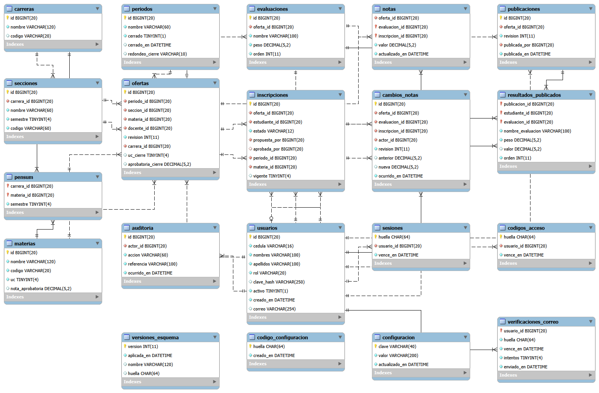

# Documentación técnica de Mérito

Versión 1.0.0

Este documento explica cómo funciona Mérito por dentro: de qué piezas está hecho, cómo guarda la información, qué reglas aplica, cómo calcula las notas, cómo deben venir los archivos de Excel, cómo protege los datos y qué se puede configurar. El paso a paso de instalación y de uso está en el Manual de Mérito.

## 1. Cómo está hecho

Mérito tiene tres piezas:

| Pieza | Dónde corre | Qué hace |
|---|---|---|
| Programa Mérito | En cada computadora donde se trabaja. | Es lo que ven administración, docentes y estudiantes. No guarda información propia: todo lo pide al servidor y todo lo envía al servidor. |
| Servicio de Mérito | En el servidor, como servicio de Windows, sin ventana. | Recibe lo que piden los programas, comprueba quién es cada persona y qué puede hacer, aplica las reglas académicas y guarda o entrega la información. |
| Base de datos | En el servidor, también como servicio de Windows. | Guarda toda la información. Solo acepta conexiones del propio servidor: ninguna otra computadora de la red puede entrar a ella. |

Los programas se comunican con el servicio por la red local, en el puerto 5187. No hace falta internet, salvo para el envío de códigos por correo.

Todas las reglas se aplican en el servidor. Aunque alguien manipulara el programa de una computadora, no podría saltarse una regla, porque el servidor la vuelve a revisar antes de guardar. Muchas reglas están además en la propia base de datos, que rechaza cualquier dato que no las cumpla.

Tecnología usada:

| Componente | Tecnología |
|---|---|
| Lenguaje y plataforma | C# sobre .NET 10, incluido dentro del instalador |
| Programa de escritorio | WPF (Windows Presentation Foundation) |
| Servicio | ASP.NET Core, como servicio de Windows |
| Base de datos | MariaDB 11.4, incluida dentro del instalador, con el conector MySqlConnector |
| Lectura y plantillas de Excel | Archivos .xlsx, con la biblioteca ClosedXML |
| Documentos en PDF | PDFsharp y MigraDoc |
| Envío de correos | SMTP con conexión cifrada, con la biblioteca MailKit |
| Instalador | Inno Setup: un solo archivo para servidor y clientes |

El instalador lleva todo lo necesario: no hay que instalar .NET, MariaDB ni ningún otro componente aparte, ni definir variables de entorno.

## 2. Qué hace el instalador

### 2.1 En el servidor

1. Copia el programa y la base de datos.
2. Crea la base de datos como servicio de Windows, escuchando solo dentro del propio equipo.
3. Crea tres cuentas internas de la base de datos con contraseñas aleatorias de 40 caracteres: una para crear y actualizar las tablas, otra para el trabajo diario del servicio y otra, de solo lectura, para los respaldos. Nadie tiene que conocer esas contraseñas.
4. Crea las tablas y aplica permisos mínimos: la cuenta del trabajo diario solo puede hacer lo que el sistema necesita y no puede borrar notas publicadas, historia de notas ni el historial de cambios.
5. Registra el servicio de Mérito para que arranque solo con el equipo y se reinicie si falla. Corre con una cuenta propia de Windows, no con permisos de sistema.
6. Abre el puerto 5187 en el firewall, solo para la red local.
7. Programa el respaldo diario a la hora elegida.
8. Deja lista la plantilla del archivo de correo.
9. Genera el código de configuración, de un solo uso, para crear la primera cuenta de administración desde el programa.
10. Comprueba que el servicio responde y muestra la dirección del servidor y el código.

Si el instalador se ejecuta otra vez sobre un servidor ya instalado, actualiza el programa y las tablas sin tocar la información, las contraseñas internas ni el correo configurado.

### 2.2 En cada cliente

1. Copia el programa.
2. Guarda la dirección del servidor para todos los usuarios de ese equipo.
3. Crea los accesos directos.

Al desinstalar un cliente se quitan el programa, los accesos y la dirección guardada. Al desinstalar el servidor se pregunta si borrar también la información; por defecto se conserva.

## 3. Tipos de cuenta y permisos

| Acción | Administración | Docente | Estudiante |
|---|---|---|---|
| Configurar reglas, carreras, pensum, secciones y períodos | Sí | No | No |
| Crear cuentas, emitir códigos, activar y desactivar | Sí | No | No |
| Asignar docentes a materias | Sí | No | No |
| Importar la matrícula del período | Sí | No | No |
| Importar estudiantes en una materia | Sí, quedan confirmados | Sí, en sus materias; quedan pendientes | No |
| Confirmar, rechazar y retirar inscripciones | Sí | No | No |
| Ver una planilla | Todas | Solo las suyas | No |
| Armar el plan de evaluación, cargar notas y publicar | No | Solo en sus materias | No |
| Generar la hoja de códigos de una sección | Sí | En sus materias | No |
| Revisar y cerrar el período | Sí | No | No |
| Ver el historial de cambios | Sí | No | No |
| Ver un récord | No | No | Solo el propio, y solo lo publicado |

El tipo de cuenta lo decide el servidor a partir de la sesión. Nadie puede elegir su propio rol, y el récord se busca siempre por la persona que inició sesión, no por una cédula que se escriba en pantalla.

## 4. Estados

### 4.1 Período

| Estado | Qué se puede hacer |
|---|---|
| Abierto | Todo: carga académica, matrícula, evaluaciones, notas y publicaciones. |
| Cerrado | Nada. Las notas quedan fijas y cuentan para el índice. El nombre del período tampoco se puede cambiar. |

Un período solo se cierra si cada una de sus materias tiene matrícula confirmada, ninguna inscripción pendiente, un plan de evaluación que suma 100 %, todas las notas cargadas y la última versión publicada.

### 4.2 Inscripción de un estudiante en una materia

| Estado | Significado |
|---|---|
| Pendiente | La propuso un docente. Todavía no aparece en las notas. |
| Confirmada | Está en la planilla y recibe notas. La matrícula que importa administración queda confirmada directamente. |
| Retirada | Se retiró de la materia por error de inscripción. Deja de verla en su récord, pero sus notas no se borran. Puede inscribirse en otra sección de esa materia. |

### 4.3 Planilla de una materia

| Estado | Significado |
|---|---|
| Sin publicar | Hay notas guardadas, pero los estudiantes todavía no ven nada. |
| Publicado | Los estudiantes ven exactamente lo que está en la planilla. |
| Cambios sin publicar | Se publicó antes, pero después hubo cambios. Los estudiantes ven la publicación anterior. |
| Cerrado | El período se cerró. |

Cada publicación queda guardada tal como se publicó. Corregir una nota después no cambia lo que el estudiante ve hasta la siguiente publicación.

### 4.4 Cuenta

| Estado | Significado |
|---|---|
| Sin registrar | La persona existe en Mérito pero todavía no creó su contraseña. |
| Activa | Tiene contraseña y puede entrar. |
| Inactiva | Administración la desactivó. No puede entrar y sus sesiones abiertas se cortan al momento. Su información se conserva. |

Las cuentas nunca se borran.

## 5. Reglas de calificación y cálculos

### 5.1 Reglas que configura la universidad

| Regla | Valor de fábrica | Opciones |
|---|---|---|
| Escala | 1 a 20 | Cualquier par de enteros entre 0 y 100. |
| Nota aprobatoria | 10 | Cualquier valor dentro de la escala, con hasta dos decimales. Cada materia puede tener la suya. |
| Redondeo de la definitiva | Medio punto | Medio punto, al entero o sin redondeo. |
| Índice | Ponderado por UC | Ponderado por UC o promedio simple. |
| Aplazadas en el índice | Sí | Sí o no. |

La escala no se puede cambiar después de cargada la primera nota. Lo demás se puede ajustar en cualquier momento, y cada período cerrado conserva las reglas con que cerró.

### 5.2 Cálculo

- **Puntos de una evaluación** = nota × porcentaje ÷ 100. Los puntos nunca se redondean.
- **Acumulado** = suma de los puntos de las evaluaciones con nota.
- **Definitiva**: existe solo cuando el plan suma 100 % y todas las evaluaciones tienen nota. Es el acumulado redondeado una sola vez con la regla elegida:
  - Medio punto: si lo que pasa del entero es menos de 0,50 baja al entero, si es 0,50 se queda en ,50 y si es más sube al siguiente entero. 9,3 queda 9; 9,5 queda 9,5; 9,7 queda 10.
  - Al entero: desde 0,50 sube. 9,5 queda 10.
  - Sin redondeo: queda con dos decimales.
- **Condición**: aprobada si la definitiva es igual o mayor a la nota aprobatoria de la materia, o a la general si la materia no tiene una propia.
- **Índice ponderado** = suma de definitiva × UC, dividida entre la suma de UC. Solo cuentan los períodos cerrados y las materias de 0 UC no pesan.
- **Promedio simple** = promedio de las definitivas de los períodos cerrados.
- **UC aprobadas** = suma de las UC de las materias aprobadas en períodos cerrados.

Al cerrar un período, cada materia guarda las UC y la nota aprobatoria que tenía en ese momento, y el período guarda el redondeo. Si después se corrigen las UC de una materia o cambia el reglamento, los récords de períodos ya cerrados no cambian.

Ejemplo: un estudiante saca 17 en un parcial de 30 %, 15 en otro de 30 % y 18 en un proyecto de 40 %. Suma 5,1 + 4,5 + 7,2 = 16,8 puntos. Con redondeo de medio punto la definitiva es 17 y queda aprobada.

## 6. Cómo se guarda la información

### 6.1 Diagrama de relaciones

La versión en tamaño A3, para imprimir, viene aparte como `Diagrama de relaciones.pdf`.

### 6.2 Qué guarda cada tabla

| Tabla | Qué guarda |
|---|---|
| usuarios | Cada persona: cédula única, nombres, tipo de cuenta, contraseña protegida, si está activa y correo único. |
| sesiones | Las sesiones abiertas y cuándo vencen. |
| codigos_acceso | Los códigos de acceso entregados por administración o en la hoja de una sección, y cuándo vencen. |
| verificaciones_correo | El código enviado al correo de una persona, cuándo vence y cuántos intentos lleva. |
| codigo_configuracion | El código de un solo uso para crear la primera cuenta de administración. |
| configuracion | El formato del código de sección y las reglas de calificación. |
| periodos | Los períodos, si están cerrados y el redondeo con que cerraron. |
| carreras | Las carreras, con nombre y código únicos. |
| materias | Las materias, con su código único, sus UC y su nota aprobatoria propia. |
| pensum | Qué materias tiene cada carrera y en qué semestre. |
| secciones | Las secciones de cada carrera, con su semestre, su nombre corto y su código completo. |
| ofertas | La carga académica: qué materia se dicta en qué sección y período, y con qué docente. |
| inscripciones | Qué estudiante está en qué materia y en qué estado. |
| evaluaciones | El plan de evaluación de cada materia. |
| notas | La nota de cada estudiante en cada evaluación. |
| cambios_notas | Cada cambio de nota: la anterior, la nueva, quién y cuándo. |
| publicaciones | Cada vez que un docente publicó. |
| resultados_publicados | Lo que vio el estudiante en cada publicación. Es lo único que muestra el récord. |
| auditoria | El historial de cambios: quién hizo qué y cuándo. |
| versiones_esquema | Las actualizaciones aplicadas a la base de datos. |

### 6.3 Reglas que garantiza la base de datos

Estas reglas no dependen del programa: la base de datos rechaza cualquier dato que no las cumpla.

- Una cédula, un correo, un nombre de carrera, un código de carrera, un código de materia y un nombre de período no se pueden repetir.
- Dos secciones de la misma carrera no pueden tener el mismo código.
- Una materia solo se puede asignar a una sección si está en el pensum de la carrera de esa sección.
- Un estudiante no puede estar dos veces en la misma materia del mismo período, ni siquiera en secciones distintas. Una inscripción retirada no cuenta, para que pueda inscribirse en otra sección.
- Una nota solo puede pertenecer a una evaluación y a una inscripción de la misma materia.
- Las notas están entre 0 y 100, y los porcentajes entre 0,01 y 100.
- Un período cerrado siempre tiene guardado su redondeo.
- Nada se borra en cascada: no se puede eliminar algo que otro dato necesita.

### 6.4 Trabajo simultáneo

Varias personas pueden trabajar al mismo tiempo. Si dos personas modifican la misma planilla a la vez, la segunda que guarda recibe el aviso «Otra operación modificó esta planilla» y debe recargar: nunca se pisa el trabajo de otra persona sin que lo sepa.

Cada operación se guarda completa o no se guarda. Si se corta la luz o la red en medio de una importación, una publicación o un cierre, no queda nada a medias.

## 7. Archivos de Excel

Mérito lee tres archivos: el pensum de una carrera, la nómina docente y la matrícula. Desde el programa se descarga una plantilla de cada uno.

### 7.1 Cómo se leen

- Formato `.xlsx`, de máximo 1 MB y con una sola hoja.
- La fila de títulos se busca en las primeras 10 filas. Las plantillas la traen en la fila 4.
- Cada columna se reconoce por su título, en cualquier orden. No importan mayúsculas ni tildes en los títulos. Se aceptan varios títulos para la misma columna, por ejemplo «cédula», «ci» o «cédula de identidad».
- Las columnas que Mérito no usa se ignoran.
- Las filas vacías se saltan.
- Las celdas con fórmulas no se aceptan.
- Antes de abrir el archivo se revisa que no sea un archivo manipulado para ocupar demasiado espacio al descomprimirse.

### 7.2 Cómo se importan

La importación tiene siempre dos pasos:

1. **Revisión.** Mérito lee el archivo y valida cada fila sin guardar nada. Si hay errores, los muestra todos con su número de fila. Si no hay, muestra qué pasará con cada fila.
2. **Confirmación.** Al confirmar, Mérito vuelve a validar todo y lo guarda de una sola vez. Si en ese momento algo ya no es válido, por ejemplo porque otra persona cambió una sección, no se guarda nada.

Importar dos veces el mismo archivo no duplica nada: lo que ya estaba se reconoce y se deja igual.

### 7.3 Datos comunes

| Dato | Regla |
|---|---|
| Cédula | De 5 a 10 números, con o sin V delante. Los puntos, espacios y guiones se ignoran. No se aceptan otros prefijos. |
| Nombres y apellidos | Obligatorios, hasta 100 caracteres cada uno. |
| Correo | Opcional. Se guarda en minúsculas. Debe tener forma de correo, no repetirse en el archivo y no pertenecer a otra persona. |

### 7.4 Pensum

| Columna | Obligatoria | Títulos aceptados | Contenido |
|---|---|---|---|
| código | Sí | código, código de materia | De 1 a 20 letras, números, puntos, guiones o guion bajo. Se guarda en mayúsculas. |
| materia | Sí | materia, asignatura, nombre de la materia | Nombre de la materia. |
| uc | Sí | uc, u.c., unidades de crédito | Número entero de 0 a 60. |
| semestre | Sí, puede ir vacía | semestre | De 1 a 20. Vacío o 0 para electivas. |

Hasta 400 materias por archivo, un archivo por carrera. Para cada fila Mérito decide:

| Situación | Resultado |
|---|---|
| El código no existe | Materia nueva. |
| El código existe en otra carrera, con el mismo nombre y UC | Se agrega a esta carrera sin duplicarla. |
| El código ya está en esta carrera en otro semestre | Cambia de semestre. |
| El código ya está igual | Sin cambios. |
| El código existe con otro nombre o con otras UC | Error: hay que revisar el código o corregir la materia antes de importar. |

### 7.5 Nómina docente

| Columna | Obligatoria | Títulos aceptados |
|---|---|---|
| cédula | Sí | cédula, cédula de identidad, ci, c.i. |
| nombres | Sí | nombres, nombre |
| apellidos | Sí | apellidos, apellido |
| correo | No | correo, correo electrónico, email, e-mail |

Hasta 2.000 docentes por archivo, cada cédula una sola vez. Si la cédula ya existe como docente con el mismo nombre, no se duplica y se le agrega el correo si no tenía. Si existe con otro nombre o con otro tipo de cuenta, la fila es un error.

### 7.6 Matrícula

| Columna | Obligatoria | Títulos aceptados | Contenido |
|---|---|---|---|
| cédula | Sí | cédula, cédula de identidad, ci, c.i. | Cédula del estudiante. |
| nombres | Sí | nombres, nombre | |
| apellidos | Sí | apellidos, apellido | |
| carrera | Sí | carrera | Nombre de la carrera igual que en Mérito. No importan mayúsculas; las tildes sí. |
| sección | Sí | sección, código de sección | Código completo o nombre corto de la sección. |
| correo | No | correo, correo electrónico, email, e-mail | |
| materias | No | materias, códigos de materias | Vacío: todas las materias asignadas a la sección. Con códigos: solo esas. |

**Matrícula del período**, la que importa administración con todas las secciones:

- Hasta 20.000 filas.
- Cada estudiante queda inscrito y confirmado en las materias asignadas a su sección en ese período, o solo en las que indique la columna materias.
- En la columna materias los códigos se separan con coma, punto y coma, barra, espacio o salto de línea. Hasta 30 códigos por fila.
- Una misma cédula puede aparecer en varias filas, por ejemplo para una materia de otro semestre. En todas debe tener el mismo nombre y el mismo correo.
- Si el nombre corto de la sección se repite dentro de la carrera, hay que usar el código completo.
- No se inscribe una materia que el estudiante ya aprobó en un período cerrado, ni una que ya cursa en otra sección del mismo período. Esas se omiten con su motivo y el resto de la fila sí se inscribe.
- Si un estudiante fue retirado de una materia, para volver a inscribirlo en esa misma materia hay que hacerlo desde la planilla de la materia.
- Hasta 2.000 estudiantes por materia.

**Matrícula de una sola materia**, desde su planilla:

- Carrera y sección deben coincidir con las de esa materia.
- Cada cédula una sola vez.
- Si la importa un docente, las inscripciones quedan pendientes y los correos se ignoran. Solo la matrícula que importa administración guarda correos, para que nadie pueda poner su correo en la cuenta de otra persona.
- La matrícula nunca reemplaza el correo de una cuenta que ya creó su contraseña.

Mensajes de error de la matrícula:

| Mensaje | Causa |
|---|---|
| Escribe la cédula con 5 a 10 números; puede llevar V- delante. | Cédula con letras, otro prefijo o pocos números. |
| No hay ninguna carrera «…» con secciones. Escríbela igual que en Mérito, con sus tildes. | La carrera está escrita distinto. |
| No existe la sección … en … | La sección no existe en esa carrera. |
| Hay varias secciones … en …: usa el código completo. | El nombre corto se repite en la carrera. |
| La sección … no tiene materias asignadas en … | Falta la carga académica de esa sección. |
| La sección … no tiene la materia … en … | Un código de la columna materias no está asignado a esa sección. |
| … aparece dos veces para la cédula … | La misma materia en dos filas del mismo estudiante. |
| La cédula … está en la fila … con otro nombre o correo. | La misma cédula con datos distintos. |
| La cédula … ya existe con otra identidad o cargo. | La cédula es de otra persona en Mérito o de un docente. |
| El correo … está en varias cédulas del archivo. | Correo repetido entre estudiantes. |
| «…» no parece un correo válido. | Correo incompleto o con espacios. |
| No se admiten fórmulas en la matrícula. | La fila tiene una fórmula. |
| Faltan columnas: … | La fila de títulos no tiene esa columna. |
| La columna «…» está dos veces en la fila de títulos. | Título repetido. |
| El archivo debe tener una sola hoja. | El libro tiene varias hojas. |
| El archivo debe pesar como máximo 1 MB. | Archivo demasiado grande. |

## 8. Cuentas y acceso

### 8.1 Primera cuenta de administración

El instalador no pide cédula ni contraseña. Genera un código de un solo uso; con él, desde el programa, se crea la primera cuenta de administración. En la base de datos solo se guarda una huella del código, no el código. Cuando ya existe una cuenta de administración, el código deja de servir y se borra.

### 8.2 Formas de crear o recuperar la contraseña

| Forma | Quién la da | Duración | Usos |
|---|---|---|---|
| Código por correo | Mérito lo envía al correo registrado. | 15 minutos | 1, con hasta 5 intentos. Un minuto de espera entre envíos. |
| Código individual | Administración, después de verificar la identidad. | 30 minutos | 1 |
| Hoja de códigos de una sección | El docente o administración, desde la planilla. | De 1 a 30 días, 7 por defecto | 1 cada código. Generar otra hoja anula la anterior. Solo incluye a quienes nunca crearon contraseña. |

Los códigos tienen 16 letras y números sin caracteres que se confundan entre sí. En la base de datos solo se guarda su huella.

### 8.3 Contraseñas y sesiones

- Las contraseñas tienen entre 12 y 128 caracteres.
- Se guardan con una derivación criptográfica de 600.000 iteraciones y una sal distinta para cada persona. No hay forma de recuperar una contraseña a partir de lo guardado: ni administración ni quien tenga acceso a la base de datos puede verla.
- Una sesión dura 8 horas. Cambiar la contraseña o desactivar la cuenta cierra todas las sesiones abiertas de esa persona.
- Desde una misma computadora se admiten hasta 20 intentos de inicio de sesión, activación o registro por minuto.

## 9. Seguridad

| Tema | Cómo está resuelto |
|---|---|
| Acceso a la base de datos | Solo desde el propio servidor. Las computadoras de la red hablan con el servicio, nunca con la base de datos. |
| Cuentas internas | Tres cuentas con contraseñas aleatorias y permisos mínimos para cada tarea. |
| Servicio | Corre con una cuenta propia de Windows, sin permisos de sistema. |
| Configuración privada | En una carpeta del servidor que solo pueden leer los administradores de Windows y el servicio. |
| Red | Dentro de la red local se acepta la conexión sin certificado. Desde fuera de la red local solo se acepta conexión cifrada. |
| Archivos subidos | Máximo 1 MB por archivo. Se rechazan fórmulas y archivos manipulados. |
| Historial | Cada cambio de nota y cada operación de administración quedan registrados con quién y cuándo. Nadie puede borrarlos desde el programa. |
| Registros técnicos | Nunca contienen contraseñas, códigos ni claves internas. |

## 10. Configuración

### 10.1 Desde el programa

Desde el propio programa, en Administración, se configuran:

- Las reglas de calificación.
- El formato del código de sección.
- Las carreras, el pensum, las secciones y los períodos.

Ninguno de estos cambios necesita reinstalar ni reiniciar nada.

### 10.2 Cuenta de correo

La cuenta que envía los códigos se configura en el archivo `correo.json`, en la carpeta privada del servidor, sin reinstalar ni recompilar nada. El Manual de Mérito explica dónde está y cómo editarlo.

| Campo | Contenido | Si se deja vacío |
|---|---|---|
| Servidor | Servidor de correo saliente. | smtp.gmail.com |
| Puerto | Puerto del servidor de correo. | 587 |
| Usuario | La dirección de correo. | No hay envío de correos. |
| Clave | La contraseña de aplicación de esa cuenta. Los espacios se ignoran. | No hay envío de correos. |
| Remitente | La dirección que aparece como remitente. | La misma de Usuario. |
| Nombre | El nombre que aparece como remitente. | Mérito |

Comportamiento:

- Los cambios se toman al reiniciar el servicio de Mérito.
- Sin usuario o sin clave, Mérito funciona igual, pero no ofrece «¿Primera vez u olvidaste tu contraseña?» y las cuentas se activan con códigos.
- Si el archivo tiene un error de escritura, el servicio arranca igual, sin correo, y deja en el Visor de eventos un aviso con el número de línea del error.
- La conexión con el servidor de correo es cifrada. Primero se intenta por el puerto configurado y, si no conecta, por el 465.

### 10.3 Conexión cifrada dentro de la red

Si la red de la universidad es abierta al público, se puede exigir conexión cifrada también dentro de la red local activando la opción `ExigirHttps` en la configuración del servidor. Para eso hace falta instalar antes un certificado en el servidor.

## 11. Respaldos

- El respaldo diario se hace sin detener el servicio y obtiene una copia coherente aunque haya gente trabajando.
- Solo se conserva si terminó completo. Se guarda comprimido junto con una huella que permite comprobar que no se dañó.
- Cada respaldo queda anotado en un registro dentro de la carpeta de respaldos.
- Los respaldos de más de 30 días se borran solos.
- Antes de restaurar, Mérito compara la huella del archivo. Si no coincide, no toca nada.
- No restaura encima de la base de datos en uso salvo que se indique de forma expresa.

El Manual de Mérito trae los pasos para hacer un respaldo en el momento y para recuperar la información.

## 12. Registro de eventos

El servicio de Mérito anota en el Visor de eventos de Windows del servidor, registro Aplicación, con el origen **Merito**:

- Al arrancar, si el correo quedó configurado, si falta o si el archivo tiene un error.
- Cualquier error inesperado, con una referencia.

Cuando un usuario ve un error con una referencia, esa misma referencia aparece en el Visor de eventos con el detalle completo. En cada computadora el programa también guarda un registro de los errores inesperados.

## 13. Límites

| Límite | Valor |
|---|---|
| Archivo de Excel | 1 MB |
| Filas de la matrícula del período | 20.000 |
| Estudiantes por materia | 2.000 |
| Docentes por archivo de nómina | 2.000 |
| Materias por archivo de pensum | 400 |
| Evaluaciones por materia | 30 |
| Códigos de materia por fila de matrícula | 30 |
| Unidades de crédito por materia | 0 a 60 |
| Semestres | 1 a 20 |
| Escala de notas | entre 0 y 100 |
| Materias por asignación en bloque | 60 |
| Contraseña | 12 a 128 caracteres |
| Duración de una sesión | 8 horas |

Otros límites de alcance:

- Un solo servidor por institución. No hay sincronización entre servidores ni trabajo sin conexión.
- Está pensado para la red local. Publicarlo en internet requiere conexión cifrada con certificado y una revisión de seguridad aparte.
- El récord es una consulta académica, no una constancia con validez legal.
- Solo cédulas venezolanas, con o sin V.

## 14. Pruebas realizadas

Antes de la entrega se probó:

- **Reglas, permisos y cálculos:** 294 comprobaciones automáticas contra una base de datos real. Incluyen permisos por tipo de cuenta, cálculos con cada tipo de redondeo, trabajo simultáneo sobre la misma planilla, publicación, matrícula, retiros, códigos, correo y cierre. También importaciones con archivos de Excel armados con errores a propósito: columnas en otro orden, con otros títulos o de más, columnas faltantes o repetidas, títulos en otra fila, varias hojas, archivo vacío y datos inválidos por fila.
- **Programa:** 35 comprobaciones automáticas sobre las pantallas reales. Incluyen formularios, carga de notas, accesibilidad, tema de alto contraste y un recorrido de 450 acciones al azar sin un solo fallo.
- **Instalación del servidor:** creación de la base de datos, cuentas, permisos y código de configuración. Recorrido completo de un período contra el servidor recién instalado: configuración inicial, estructura, docentes, carga, matrícula, notas, publicación, récord, cierre e historial.
- **Correo:** el servicio arranca y avisa correctamente con el archivo vacío, mal escrito, completo o con la plantilla de fábrica.
- **Respaldos:** respaldo, restauración en otra base, restauración encima de la base en uso y rechazo de un respaldo alterado.
- **Clientes:** instalación, actualización encima de una versión anterior y desinstalación.

Queda por comprobar en el servidor real de la universidad, porque requiere instalar servicios de Windows: el arranque automático del servicio, la regla del firewall, el respaldo programado, el registro en el Visor de eventos y la conexión desde otras computadoras de la red.
