# Manual de Mérito

Versión 1.0.0

Este manual explica Mérito desde cero: cómo se instala, cómo se deja configurado con las normas de la universidad y para qué sirve cada botón. Está pensado para que lo pueda seguir alguien que nunca ha instalado un sistema. Si se sigue en orden, de principio a fin, Mérito queda listo para usarse.

La primera vez lleva trabajo, sobre todo por las secciones, la nómina de docentes y la activación de las cuentas. Después de esa primera vez, cada período nuevo se prepara en pocos minutos.

## 1. Lo que hay que saber antes de empezar

### 1.1 Cómo funciona Mérito

Mérito se usa dentro de la red de la universidad, la misma red a la que están conectadas las computadoras de la institución. No necesita internet.

Una de esas computadoras hace de **servidor**. En ella se guarda toda la información: carreras, materias, estudiantes, notas. Esa computadora tiene que quedar encendida mientras la gente usa Mérito.

Las demás computadoras son **clientes**. Tienen instalado el programa Mérito, y el programa le pide los datos al servidor por la red. Si el servidor está apagado, los clientes no pueden entrar.

Puede pasar que la misma computadora sea servidor y cliente a la vez. El instalador tiene esa opción.

Cada persona entra con su cédula y su contraseña. Lo que ve depende de su tipo de cuenta:

| Tipo de cuenta | Qué ve | Qué hace |
|---|---|---|
| Administración | Administración y Materias y matrícula | Configura la universidad en Mérito, crea las cuentas, asigna los docentes, inscribe a los estudiantes y cierra los períodos. |
| Docente | Mis materias | Arma el plan de evaluación de sus materias, carga las notas y las publica. |
| Estudiante | Mi récord | Ve las notas que su docente ya publicó, su índice y sus unidades de crédito aprobadas. |

### 1.2 Palabras que aparecen en este manual

| Palabra | Qué significa en Mérito |
|---|---|
| Servidor | La computadora que guarda la información de todos. |
| Cliente | Cualquier computadora con el programa Mérito instalado, que se conecta al servidor. |
| Red local | Las computadoras conectadas entre sí dentro de la universidad, por cable o por Wi-Fi. |
| Dirección IP | El número que identifica a una computadora dentro de la red, por ejemplo 192.168.1.10. Los clientes lo usan para encontrar al servidor. |
| Puerto | Un número que acompaña a la IP. Mérito usa el 5187. No hay que cambiarlo. |
| Período | Un lapso académico, por ejemplo 1-2027. Las notas siempre pertenecen a un período. |
| Carrera | Ingeniería de Sistemas, Ingeniería Civil, etc. |
| Pensum | La lista oficial de materias de una carrera, con su código, sus unidades de crédito y su semestre. |
| UC | Unidades de crédito de una materia. Sirven para calcular el índice. |
| Sección | Un grupo de estudiantes de una carrera, por ejemplo la D1 del primer semestre. |
| Carga académica | Qué docente dicta cada materia en cada sección durante un período. |
| Matrícula | Qué estudiantes están inscritos en cada materia en un período. |
| Plan de evaluación | Las evaluaciones de una materia con su porcentaje, por ejemplo tres exámenes de 30 %, 30 % y 40 %. |
| Publicar | Hacer visibles las notas para los estudiantes. Hasta que el docente publica, nadie más las ve. |
| Cerrar el período | Dar por terminado el período. Las notas ya no se pueden cambiar y pasan a contar para el índice. |

### 1.3 Qué computadora será el servidor

Elige una computadora que:

- Tenga Windows 10 o Windows 11 de 64 bits. Sirve también Windows Server.
- Pueda quedar encendida durante el horario en que se trabaja con Mérito. Lo ideal es que no se apague nunca.
- No sea la que usa un estudiante o la que se presta. Mejor una de la oficina de control de estudios o de sistemas.
- Esté conectada a la red por cable, si es posible. El Wi-Fi también funciona, pero es menos estable.

### 1.4 Pedir una IP fija para el servidor

Los clientes encuentran al servidor por su dirección IP. Si esa dirección cambia, por ejemplo después de un corte de luz, los clientes dejan de conectarse. Por eso el servidor necesita una **IP fija**.

La IP fija la configura quien administra la red o el router de la universidad. Pídele que «reserve una IP fija para esta computadora». Para eso te puede pedir la dirección física del equipo, que se consulta así:

1. En el servidor, pulsa la tecla Windows, escribe `cmd` y pulsa Enter. Se abre una ventana negra.
2. Escribe `ipconfig /all` y pulsa Enter.
3. Busca el adaptador que está conectado, el de Ethernet si va por cable o el de Wi-Fi. Ahí aparecen dos datos:
   - **Dirección física**: algo como `3C-52-82-1A-7F-90`. Es la que pide quien administra la red.
   - **Dirección IPv4**: algo como `192.168.1.10`. Es la IP actual del servidor.

Anota la IP. Al final de la instalación el propio instalador también la muestra.

### 1.5 Marcar la red como privada

Windows trata las redes como públicas o privadas. En una red pública bloquea las conexiones que vienen de otras computadoras, y los clientes no podrían entrar al servidor. En el servidor:

1. Abre **Configuración** de Windows, tecla Windows + I.
2. Entra en **Red e Internet**.
3. Pulsa sobre la conexión que usa el equipo, **Ethernet** o **Wi-Fi**.
4. En **Tipo de perfil de red**, elige **Privada**.

Si la computadora está unida al dominio de la universidad, aparece como red de dominio. Esa también sirve.

### 1.6 Llevar el instalador a cada computadora

El instalador es un solo archivo: `Merito-1.0.0-instalador.exe`, de unos 97 MB. Se puede copiar con un pendrive o desde una carpeta compartida. Es el mismo archivo para el servidor y para los clientes: en uno de sus pasos se elige qué papel tendrá esa computadora.

## 2. Instalar el servidor

Se hace una sola vez, en la computadora elegida como servidor, con una cuenta de Windows que sea administradora del equipo. Tarda unos cinco minutos.

### 2.1 Abrir el instalador

Haz doble clic en `Merito-1.0.0-instalador.exe`.

Pueden aparecer dos avisos de Windows antes del asistente:

- **«Windows protegió su PC»**, en una ventana azul. Sale porque el instalador es nuevo y Windows todavía no lo conoce. Pulsa **Más información** y luego **Ejecutar de todas formas**.
- **«¿Quieres permitir que esta aplicación haga cambios en el dispositivo?»**. Pulsa **Sí**. El instalador necesita permiso de administrador para crear la base de datos y el servicio.

Si en ese segundo aviso Windows pide un usuario y una contraseña, la cuenta con la que estás no es administradora del equipo. Hay que entrar con una que sí lo sea.

### 2.2 Las pantallas del asistente

En la primera pantalla, la de bienvenida, pulsa **Siguiente**.

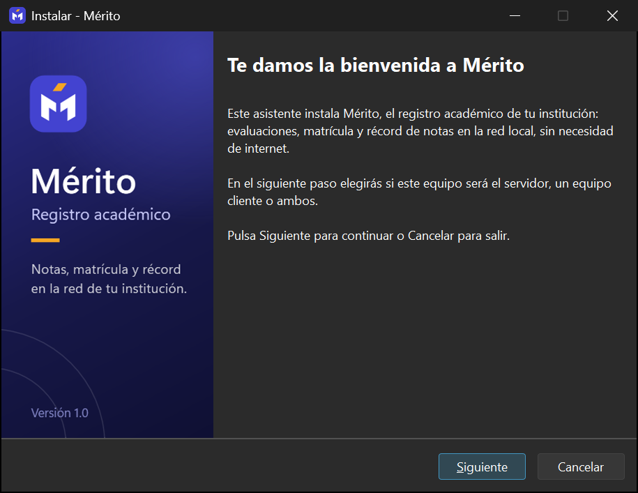

En **Carpeta de instalación** deja la que aparece, `C:\Program Files\Merito`, y pulsa **Siguiente**.

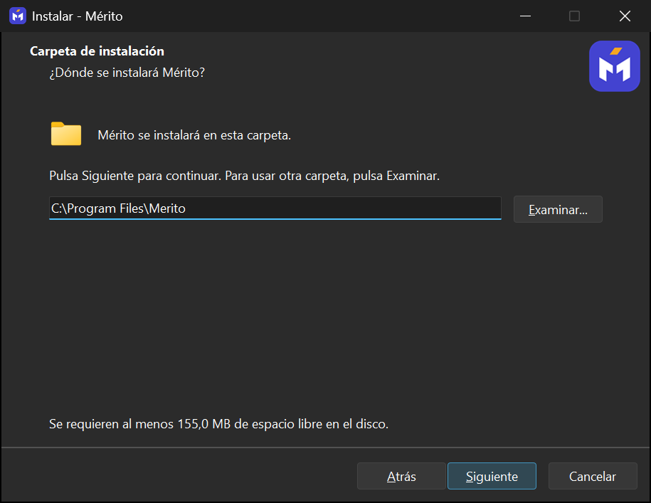

En **Papel de este equipo** se decide qué será esta computadora. Abre la lista y elige:

- **Servidor: guarda la información para toda la red**, si en esta computadora nadie va a usar el programa.
- **Servidor y cliente en este mismo equipo**, si aquí también se va a trabajar con Mérito. Es lo más común en una oficina pequeña.

Pulsa **Siguiente**.

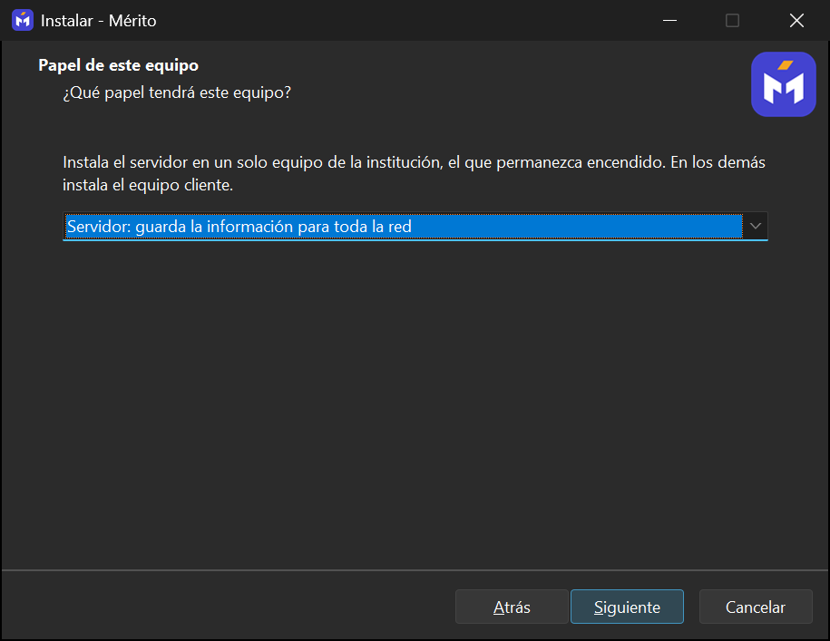

La pantalla **Opciones adicionales** solo aparece si elegiste «Servidor y cliente». Deja marcado **Crear un acceso directo en el escritorio** y pulsa **Siguiente**.

En **Respaldos automáticos** se elige dónde y a qué hora Mérito guarda cada día una copia completa de la información:

- **Carpeta de respaldos**: si la computadora tiene un segundo disco, por ejemplo `D:`, pulsa **Examinar** y elige una carpeta en ese disco. Si no, deja la que aparece.
- **Hora del respaldo diario**: una hora en la que el servidor esté encendido, escrita así: `22:00`, `13:30`. Si el servidor se apaga en la noche, pon una hora del mediodía.

Pulsa **Siguiente**.

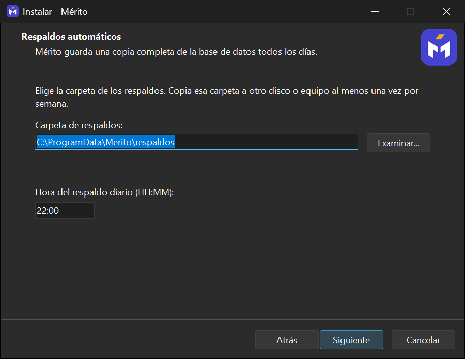

En **Todo listo para instalar** revisa el resumen y pulsa **Instalar**.

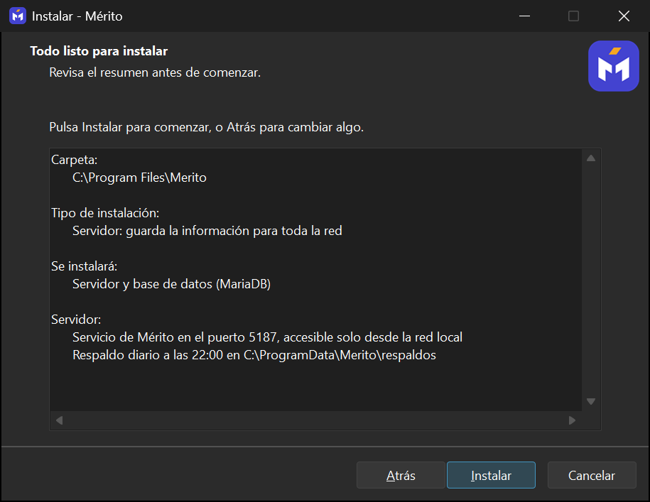

La instalación tarda uno o dos minutos. Mientras tanto la barra puede quedarse moviéndose sin avanzar: está preparando la base de datos. No cierres la ventana.

### 2.3 La última pantalla: dos datos que hay que anotar

Al terminar, el instalador muestra **«Mérito está listo»** con dos datos. Cópialos en un papel o en un documento antes de pulsar Finalizar:

1. **La dirección del servidor**, por ejemplo `192.168.1.10   (puerto 5187)`. Es lo que se escribe al instalar cada cliente.
2. **El código de configuración**, 16 letras y números en cuatro grupos, por ejemplo `K7QF-2M9X-4AB3-ZZ99`. Sirve para crear la primera cuenta de administración, y solo funciona una vez.

Si se pierde el código, está guardado en el servidor en `C:\ProgramData\Merito\privado\codigo-configuracion.txt`. Esa carpeta está oculta y protegida: hay que escribir la ruta completa en la barra del Explorador de archivos y aceptar el aviso de permisos. Cuando la cuenta de administración ya existe, el archivo se borra solo.

Si la instalación muestra «No se pudo terminar de preparar el servidor», vuelve a ejecutar el instalador. Si se repite, el detalle está en `C:\ProgramData\Merito\instalacion.log`.

### 2.4 Comprobar que el servidor funciona

En el mismo servidor, abre el navegador, Chrome, Edge o el que haya, y escribe en la barra de direcciones:

```
http://127.0.0.1:5187/salud
```

Debe aparecer un texto como `{"servicio":"merito","version":8}`. Si aparece, el servidor está funcionando.

Después haz la misma prueba desde otra computadora de la red, pero con la IP del servidor en lugar de 127.0.0.1, por ejemplo `http://192.168.1.10:5187/salud`. Si en el servidor funciona y desde otra computadora no, revisa el punto 1.5: casi siempre es la red marcada como pública.

### 2.5 Qué quedó instalado

Nada de esto se toca en el día a día, pero conviene saber dónde está:

| Qué | Dónde |
|---|---|
| El programa | `C:\Program Files\Merito` |
| La información, la configuración y los respaldos | `C:\ProgramData\Merito` |
| El servicio que atiende a los clientes | Se llama **Mérito**. Arranca solo al encender la computadora. |
| El servicio de la base de datos | Se llama **MeritoBD**. Solo acepta conexiones del propio servidor. |
| El respaldo diario | Una tarea programada de Windows llamada «Mérito, respaldo diario (merito)». |

Los servicios se ven pulsando la tecla Windows, escribiendo `services.msc` y pulsando Enter. Los dos deben decir **En ejecución**.

## 3. Instalar los clientes

Se repite en cada computadora donde se va a usar Mérito. Tarda unos dos minutos por equipo.

1. Abre `Merito-1.0.0-instalador.exe` y acepta los mismos avisos de Windows del punto 2.1.
2. **Bienvenida** y **Carpeta de instalación**: pulsa Siguiente.
3. **Papel de este equipo**: deja **Equipo cliente: se conecta al servidor de la institución** y pulsa Siguiente.

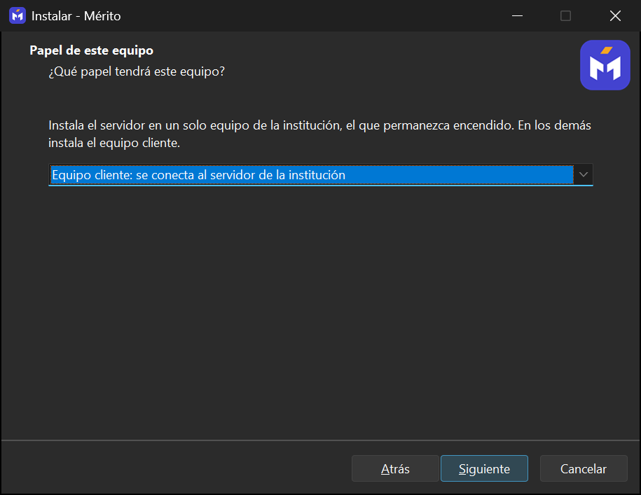

4. **Opciones adicionales**: deja marcado el acceso directo en el escritorio y pulsa Siguiente.

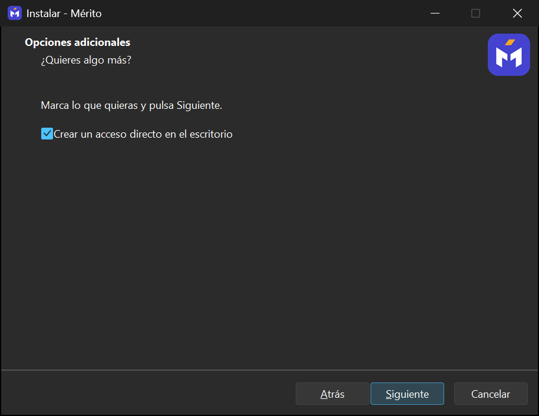

5. **Servidor de Mérito**: escribe la IP del servidor que anotaste, deja el puerto en 5187 y pulsa **Probar conexión**.

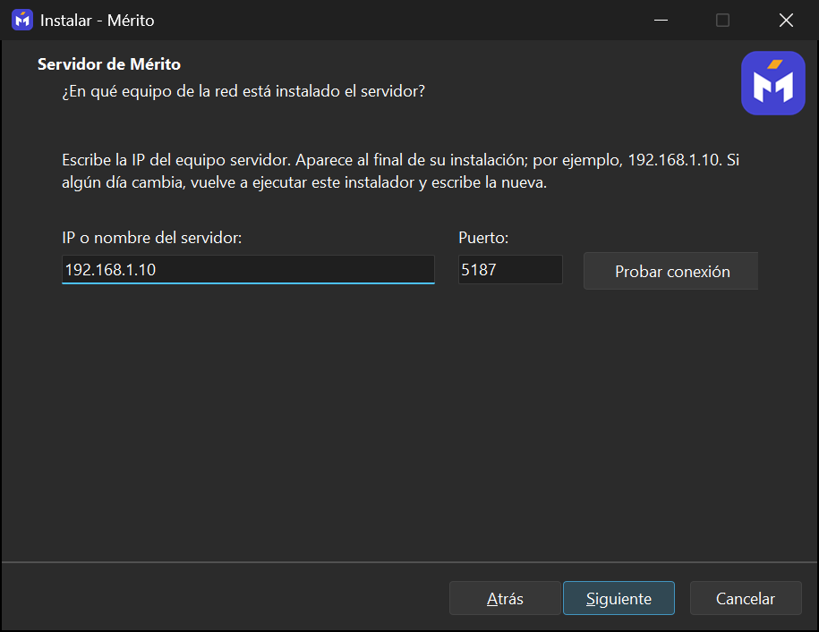

El resultado de la prueba aparece debajo de las casillas:

- «Conectado. El servidor de Mérito responde…»: todo bien, pulsa Siguiente.
- «Sin respuesta…»: el servidor está apagado, la IP está mal escrita o la red del servidor está como pública. Corrígelo antes de seguir.
- «En esa dirección responde otro programa…»: esa IP es de otra computadora. Revisa el número.

6. Pulsa **Instalar** y luego **Finalizar**. Mérito queda en el escritorio y en el menú Inicio.

### 3.1 Si son muchas computadoras

Quien sepa usar la consola de Windows puede instalar sin pasar por las pantallas. En una consola abierta como administrador, en la carpeta donde está el instalador:

```
Merito-1.0.0-instalador.exe /VERYSILENT /SUPPRESSMSGBOXES /NORESTART /TYPE=cliente /COMPONENTS=cliente /SERVIDOR=192.168.1.10 /PUERTO=5187
```

Se cambia `192.168.1.10` por la IP real del servidor. Termina sin mostrar nada.

### 3.2 Si algún día cambia la IP del servidor

Vuelve a ejecutar el instalador en cada cliente y escribe la IP nueva en la pantalla «Servidor de Mérito». No se pierde nada.

Para salir del paso en una sola computadora, en la pantalla de inicio de Mérito se pulsa **Ctrl + Mayús + S** a la vez. Aparece «Dirección del servidor»; se escribe la nueva, por ejemplo `http://192.168.1.20:5187`, y Mérito la prueba antes de guardarla. Ese cambio solo vale para el usuario de Windows que lo hizo.

## 4. Correo para que cada persona cree su contraseña

Este paso es opcional, pero ahorra mucho trabajo.

Sin correo, cada docente y cada estudiante necesita un código que le entrega administración o su docente para crear su contraseña. Con correo, la persona escribe su cédula en la pantalla de inicio, recibe un código en su correo y crea su contraseña sola. Lo mismo sirve si algún día la olvida.

El correo se configura en un archivo del servidor. No hace falta reinstalar nada.

### 4.1 Crear la cuenta de Gmail

1. Crea una cuenta de Gmail para Mérito, por ejemplo `registro.merito.universidad@gmail.com`. También puede ser un correo de la institución.
2. Entra a esa cuenta, abre **Gestionar tu cuenta de Google** y ve a **Seguridad**.
3. Activa la **Verificación en dos pasos**. Google pide un número de teléfono: tiene que ser el de la persona que va a cuidar esa cuenta, porque a ese teléfono llegarán los avisos de seguridad.
4. Con la verificación en dos pasos ya activa, busca **Contraseñas de aplicaciones**. Si no aparece en Seguridad, escribe «contraseñas de aplicaciones» en el buscador que está arriba en la página de la cuenta.
5. Crea una con el nombre `Mérito`. Google muestra **16 letras** en cuatro grupos. Esa es la clave que va en Mérito, no la contraseña normal de la cuenta. Cópiala en ese momento, porque Google no la vuelve a mostrar.

### 4.2 Escribir los datos en el servidor

1. En el servidor, pulsa la tecla Windows y escribe `Bloc de notas`. Haz clic derecho sobre él y elige **Ejecutar como administrador**.
2. En el Bloc de notas, **Archivo › Abrir**. En la casilla «Nombre de archivo» escribe `C:\ProgramData\Merito\privado\correo.json` y pulsa Abrir.
3. Verás esto:

```
{
    "Servidor":  "smtp.gmail.com",
    "Puerto":  587,
    "Usuario":  "",
    "Clave":  "",
    "Remitente":  "",
    "Nombre":  "Mérito"
}
```

4. Escribe la dirección de Gmail entre las comillas de `Usuario` y las 16 letras entre las comillas de `Clave`. No borres las comillas ni las comas. Debe quedar así, con tus datos:

```
{
    "Servidor":  "smtp.gmail.com",
    "Puerto":  587,
    "Usuario":  "registro.merito.universidad@gmail.com",
    "Clave":  "abcd efgh ijkl mnop",
    "Remitente":  "",
    "Nombre":  "Mérito"
}
```

5. Guarda con **Archivo › Guardar**.
6. Reinicia el servicio para que lea el cambio: tecla Windows, escribe `services.msc`, Enter, busca **Mérito**, clic derecho y **Reiniciar**.

### 4.3 Comprobar que funciona

Cierra Mérito en cualquier cliente y vuelve a abrirlo. Ahora la pantalla de inicio muestra **¿Primera vez u olvidaste tu contraseña?** debajo del botón Iniciar sesión.


Si no aparece, el servidor no pudo leer el archivo. Para saber por qué:

1. En el servidor, tecla Windows, escribe `Visor de eventos` y ábrelo.
2. Entra en **Registros de Windows › Aplicación**.
3. Busca los mensajes cuyo origen es **Merito**, del momento en que reiniciaste el servicio. Dicen una de estas tres cosas:
   - «Correo configurado: …»: quedó bien. Cierra y abre otra vez Mérito en el cliente.
   - «Sin cuenta de correo: completa … correo.json…»: falta el usuario o la clave.
   - «… correo.json está mal escrito cerca de la línea 4…»: falta una comilla o una coma en esa línea. Mientras tanto Mérito funciona sin correo.

Si algún día se cambia la contraseña de la cuenta de Gmail, Google anula la contraseña de aplicación. Hay que crear otra y repetir el punto 4.2.

## 5. Primera vez que se abre Mérito

1. Abre Mérito en cualquier cliente. Como el servidor es nuevo, la pantalla de inicio muestra el aviso **«Este servidor todavía no tiene una cuenta de administración»** con el botón **Configurar Mérito**.


2. Pulsa **Configurar Mérito** y llena el formulario:
   - **Código de configuración**: el que anotaste al final de la instalación del servidor. Da igual si se escribe con o sin guiones, en mayúsculas o minúsculas.
   - **Cédula**, **Nombres** y **Apellidos** de la persona que va a administrar Mérito.
   - **Contraseña** y **Repetir contraseña**: por lo menos 12 caracteres. Conviene una frase fácil de recordar, por ejemplo `MeritoControlEstudios2027`.

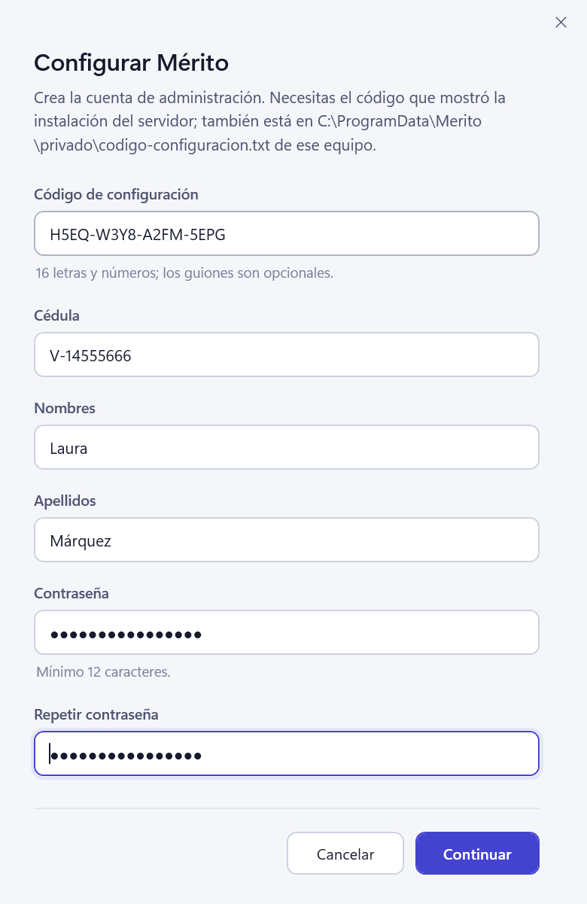

3. Pulsa **Continuar**. Aparece «Mérito quedó configurado» y el código ya no sirve más.


4. Escribe tu contraseña y pulsa **Iniciar sesión**. Se abre Administración.

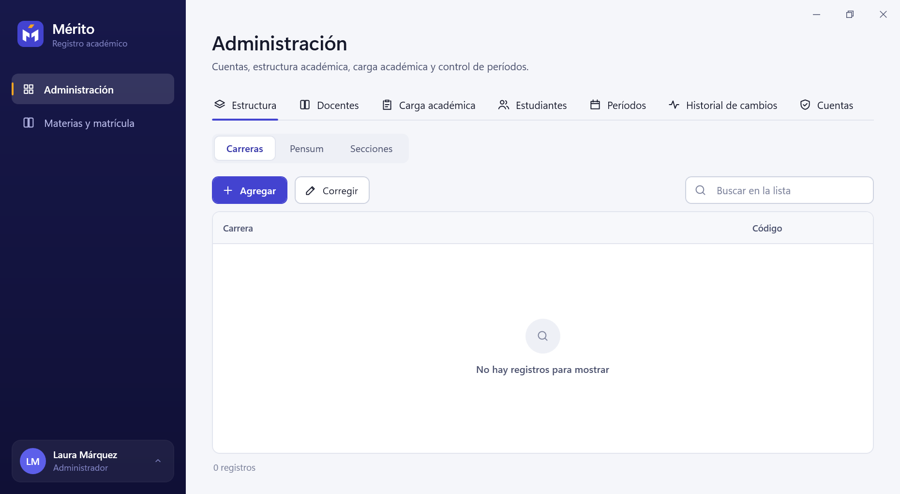

El instalador no pide cédula ni contraseña a propósito: así quien instala el servidor no conoce la clave de quien administra.

Conviene crear desde el principio una segunda cuenta de administración para otra persona de confianza, en la pestaña **Cuentas**. Si alguien olvida su contraseña, la otra persona le puede dar un código para recuperarla.

## 6. Configurar Mérito con los datos de la universidad

Esta es la parte que más tiempo lleva la primera vez. Los pasos van en orden porque cada uno usa lo que se hizo en el anterior, y Mérito no deja saltarse ninguno. Por ejemplo, no deja crear una sección si todavía no existe su carrera.

### 6.1 Reunir los datos antes de empezar

Mérito no trae datos de fábrica. Todo lo carga la universidad. Antes de sentarte a configurar, consigue esto con control de estudios y con la coordinación académica:

| Dato | A quién pedirlo | Ejemplo |
|---|---|---|
| Escala de notas y nota mínima para aprobar | Reglamento de evaluación | De 1 a 20, aprueba con 10 |
| Cómo se redondea la nota definitiva | Reglamento de evaluación | 9,5 queda en 9,5 o sube a 10 |
| Cómo se calcula el índice académico | Control de estudios | Ponderado por unidades de crédito |
| Nombre oficial y código de cada carrera | Control de estudios | Ingeniería de Sistemas, 2603 |
| Cómo se escribe el código de una sección | Control de estudios | 01S-2603-D1 |
| El pensum de cada carrera, en Excel si es posible | Coordinación de cada carrera | Código, materia, UC y semestre |
| Las secciones de cada carrera | Control de estudios | D1 y D2 de primer semestre |
| Nombre del período | Control de estudios | 1-2027 |
| La nómina de docentes, en Excel | Recursos humanos o coordinación | Cédula, nombres, apellidos, correo |
| Qué docente da cada materia en cada sección | Coordinación de cada carrera | Matemática I de la D1: prof. Duarte |
| La lista de inscritos del período, en Excel | Control de estudios | Cédula, nombres, apellidos, carrera, sección, correo |

Con eso en la mano, la configuración se hace de corrido.

En los ejemplos de este manual se usan datos inventados: la carrera Ingeniería de Sistemas con código 2603, el período 1-2027 y docentes y estudiantes de ejemplo.

### 6.2 Paso 1: reglas de calificación

Se hace en la pestaña **Períodos**, con el botón **Reglas de calificación**.

Va primero porque la escala de notas no se puede cambiar después de que alguien cargue la primera nota.

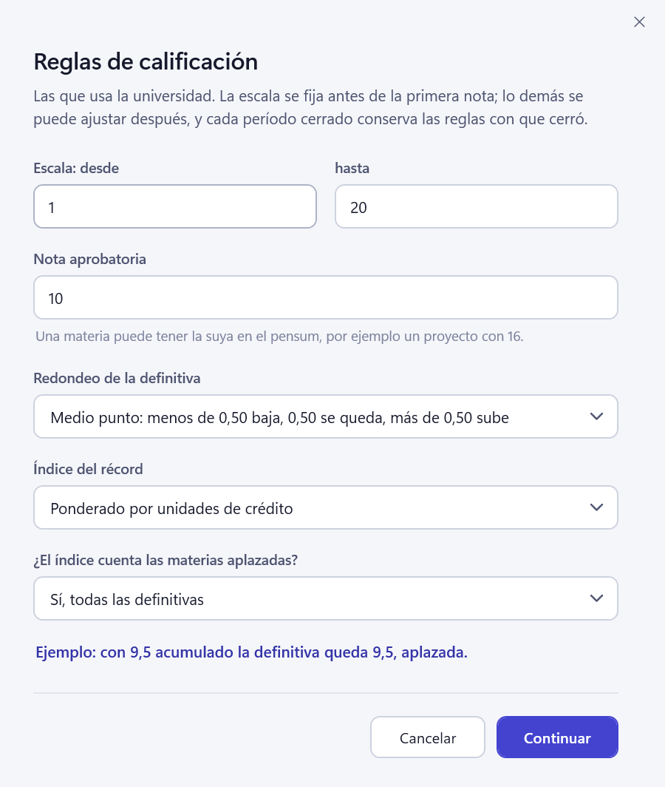

| Casilla | Qué poner |
|---|---|
| Escala: desde y hasta | La nota más baja y la más alta posibles. Casi siempre de 1 a 20. |
| Nota aprobatoria | La nota mínima para aprobar, por ejemplo 10. Se pueden usar decimales, como 9,5. |
| Redondeo de la definitiva | Cómo se redondea la nota final de cada materia. Hay tres opciones, explicadas abajo. |
| Índice del récord | **Ponderado por unidades de crédito**, que es lo normal en Venezuela, o **Promedio simple de las definitivas**. |
| ¿El índice cuenta las materias aplazadas? | **Sí, todas las definitivas** o **No, solo las aprobadas**. Depende del reglamento. |

Las tres opciones de redondeo:

- **Medio punto**: si lo que pasa del entero es menos de 0,50 se baja; si es exactamente 0,50 se queda; si es más de 0,50 se sube. Con 9,3 queda 9; con 9,5 queda 9,5; con 9,7 queda 10.
- **Al entero**: desde 0,50 se sube. Con 9,5 queda 10; con 9,4 queda 9.
- **Sin redondeo**: la definitiva queda con dos decimales, tal como sale la cuenta.

Debajo, el formulario muestra un ejemplo con lo que elegiste, como «con 9,5 acumulado la definitiva queda 9,5, aplazada». Léelo y confirma que es lo que dice el reglamento. Después pulsa **Continuar**.

Si alguna materia aprueba con otra nota, por ejemplo un proyecto que aprueba con 16, eso no se pone aquí sino en la materia, en el paso 4.

### 6.3 Paso 2: carreras

Se hace en la pestaña **Estructura**, apartado **Carreras**.

1. Pulsa **Agregar**.
2. **Nombre**: el nombre oficial completo, tal como aparece en los documentos de la universidad, con tildes. Por ejemplo «Ingeniería de Sistemas».
3. **Código de la carrera**: el número o código que usa la universidad, por ejemplo 2603. Si la universidad no usa códigos, se puede dejar vacío.
4. Pulsa **Continuar**.

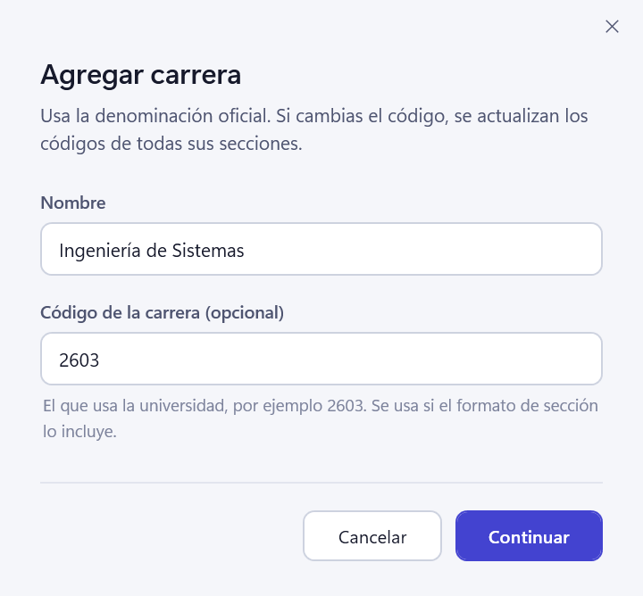

Repite con cada carrera. Al final quedan todas en la lista.

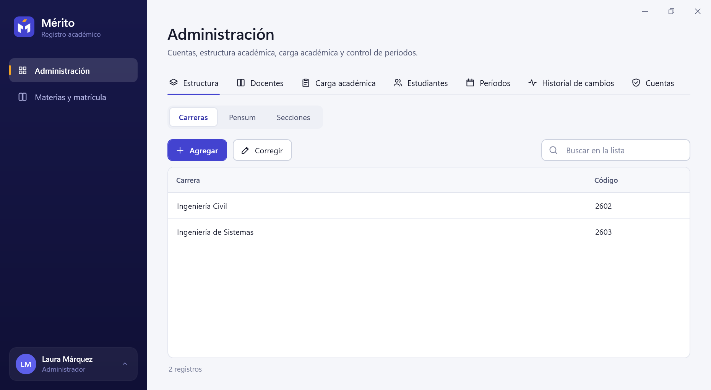

El nombre de la carrera tiene que escribirse igual en el Excel de inscritos. No importa si va en mayúsculas o minúsculas, pero las tildes sí cuentan. «Ingenieria» sin tilde no es lo mismo que «Ingeniería».

Si hay un error, selecciona la carrera y pulsa **Corregir**, o haz doble clic sobre ella.

### 6.4 Paso 3: cómo se escribe el código de las secciones

Se hace en la pestaña **Estructura**, apartado **Secciones**, con el botón **Formato del código**.

Cada sección tiene un nombre corto, como D1 o A, y un código completo, como `01S-2603-D1`. El código completo es el que se ve en las planillas, en los récords y en el Excel de inscritos. Mérito lo arma solo; aquí se le dice cómo.

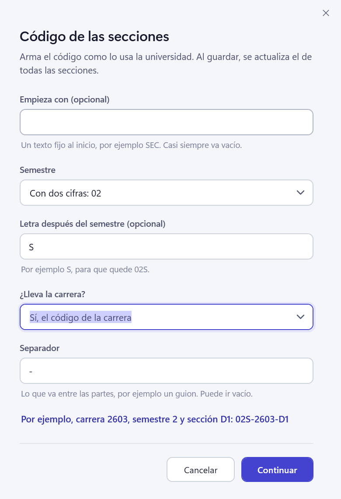

| Casilla | Para qué sirve | En el ejemplo |
|---|---|---|
| Empieza con | Un texto fijo al principio. Casi siempre se deja vacío. | vacío |
| Semestre | Si el código lleva el semestre y cómo: **No lleva semestre**, **Con dos cifras: 02** o **Sin ceros: 2**. | Con dos cifras |
| Letra después del semestre | Una letra pegada al semestre. | S, para que quede 01S |
| ¿Lleva la carrera? | Si el código lleva el código de la carrera. | Sí |
| Separador | Lo que va entre una parte y otra. | un guion |

Mérito siempre pone las partes en este orden: el texto fijo, el semestre con su letra, la carrera y el nombre corto de la sección. Mientras eliges, debajo aparece cómo quedaría, por ejemplo «02S-2603-D1». Cuando coincida con lo que usa la universidad, pulsa **Continuar**.

Si la universidad no usa códigos y llama a las secciones solo «A», «B», «C», no hace falta tocar este paso.

### 6.5 Paso 4: el pensum de cada carrera

Se hace en la pestaña **Estructura**, apartado **Pensum**.

Arriba, en **Carrera del pensum**, elige la carrera. Todo lo que hagas en este apartado aplica a esa carrera.

La forma más rápida es con Excel:

1. Pulsa **Plantilla** y guarda el archivo `pensum.xlsx` donde lo encuentres, por ejemplo en el escritorio.
2. Ábrelo y llena una fila por materia: código, nombre de la materia, UC y semestre. Las electivas van con el semestre vacío. El punto 9.4 explica cada columna.
3. Guarda el archivo y ciérralo.
4. En Mérito, con la carrera elegida arriba, pulsa **Importar Excel** y elige el archivo.
5. Aparece la revisión con lo que va a pasar con cada materia. Si está bien, pulsa **Importar pensum**.

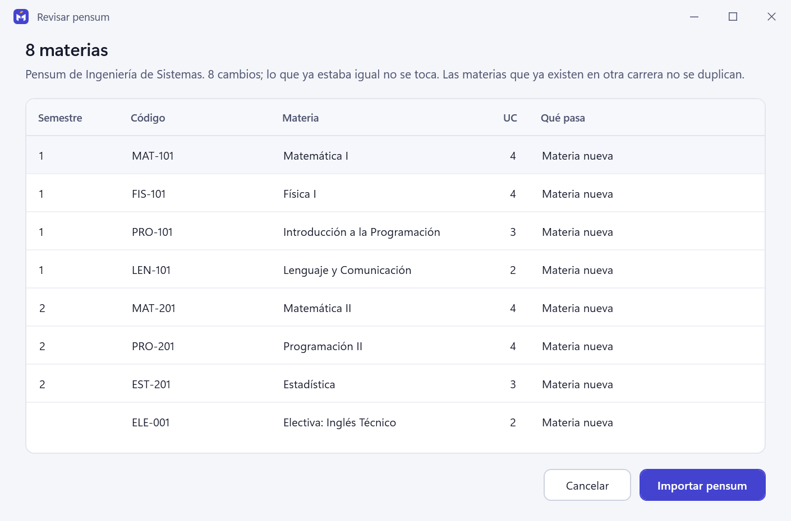

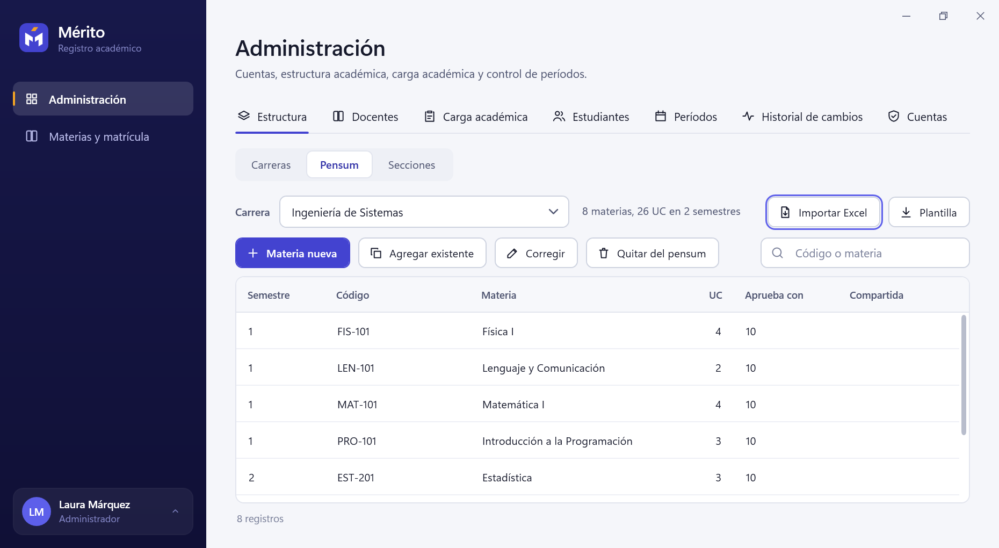

Si el archivo tiene errores, Mérito los muestra fila por fila y no guarda nada. Se corrige el Excel y se vuelve a importar.

Las materias que comparten varias carreras, como Matemática I en todas las ingenierías, se crean una sola vez con su código. Al importar el pensum de la segunda carrera con ese mismo código, Mérito la reconoce y la agrega sin duplicarla. Las notas de esa materia son las mismas para todas las carreras.

Para una materia suelta, sin Excel, pulsa **Materia nueva**:

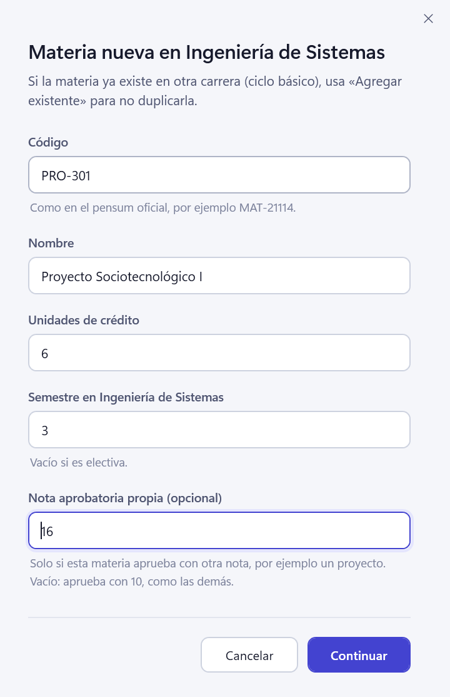

- **Código**: como en el pensum oficial.
- **Nombre**, **Unidades de crédito** y **Semestre**. El semestre se deja vacío si es electiva.
- **Nota aprobatoria propia**: solo si esa materia aprueba con una nota distinta a la general. En la imagen, un proyecto que aprueba con 16. Si aprueba como las demás, déjalo vacío.

Si la materia ya existe en otra carrera, usa **Agregar existente** en lugar de Materia nueva.

### 6.6 Paso 5: secciones

Se hace en la pestaña **Estructura**, apartado **Secciones**.

1. Pulsa **Agregar**.
2. **Carrera**: elige la carrera de la sección. Se puede escribir parte del nombre para encontrarla.
3. **Semestre**: el número, por ejemplo 1.
4. **Sección**: el nombre corto, por ejemplo D1.
5. Debajo aparece el código completo que va a quedar. Pulsa **Continuar**.

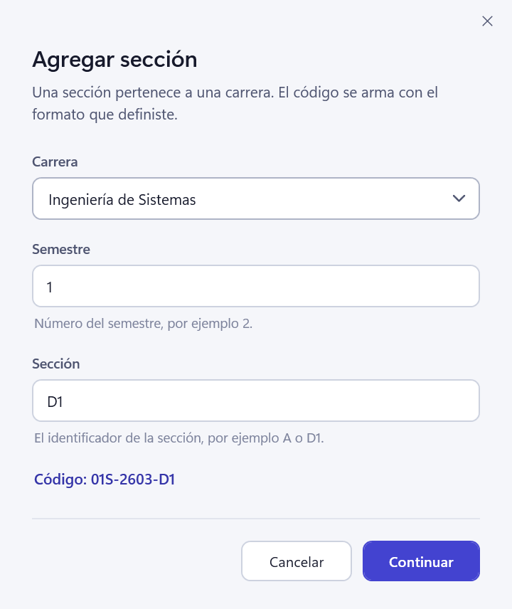

Repite con cada sección. Las secciones se crean una sola vez y sirven para todos los períodos.

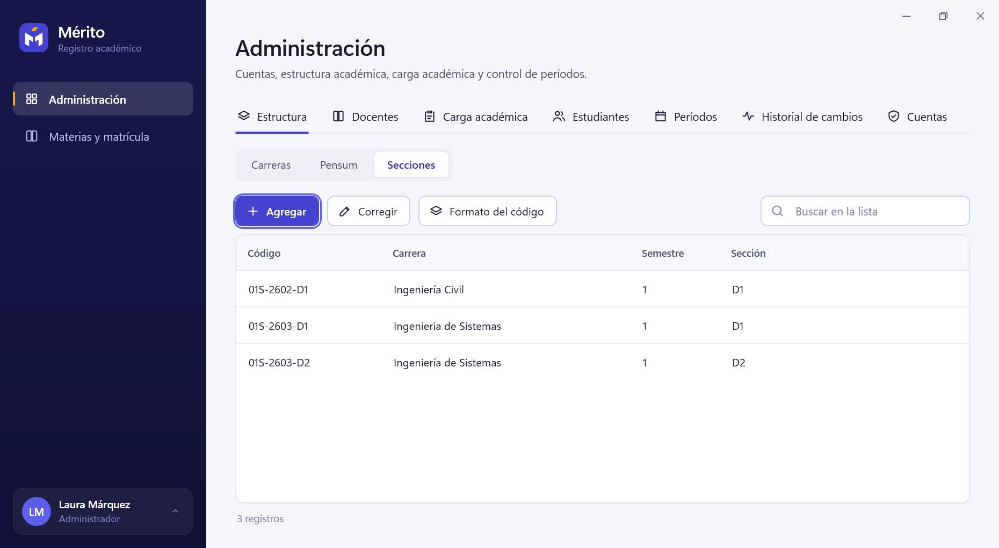

### 6.7 Paso 6: el período

Se hace en la pestaña **Períodos**, con el botón **Nuevo período**.

Escribe el nombre como lo usa la universidad, por ejemplo `1-2027` o `2027-I`, y pulsa **Continuar**. Ese nombre es el que verán los estudiantes en su récord.

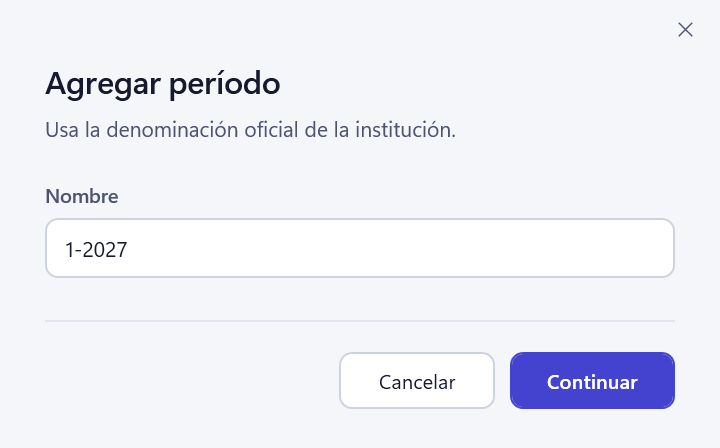

### 6.8 Paso 7: los docentes

Se hace en la pestaña **Docentes**.

Con Excel:

1. Pulsa **Plantilla** y guarda `nomina-docente.xlsx`.
2. Llena una fila por docente: cédula, nombres, apellidos y correo. El correo es opcional, pero si lo pones, el docente puede crear su contraseña solo. El punto 9.3 explica las columnas.
3. Pulsa **Importar nómina** y elige el archivo.
4. La revisión dice qué pasa con cada docente: «Docente nuevo», «Ya está; se completa el correo» o «Ya está, sin cambios». Pulsa **Importar nómina**.

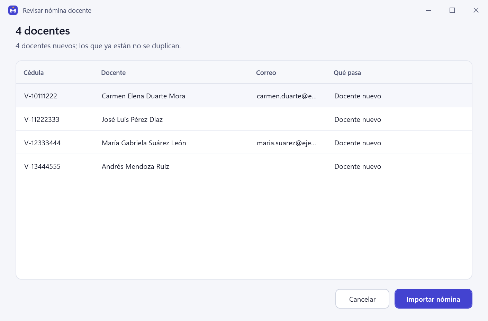

Importar la misma nómina dos veces no duplica a nadie.

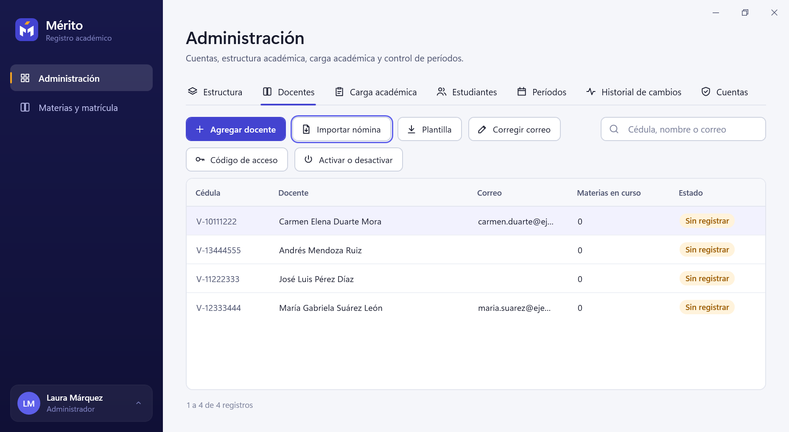

Para un docente suelto, pulsa **Agregar docente** y llena cédula, nombres, apellidos y correo.

### 6.9 Paso 8: la carga académica

Se hace en la pestaña **Carga académica**, con el botón **Asignar por sección**.

1. **Período**: el período que creaste.
2. **Sección**: elige la sección. Carrera y Semestre solo sirven para acortar la lista de secciones cuando son muchas.
3. Aparecen las materias del semestre de esa sección. En cada una, elige el docente: haz clic en la casilla y escribe parte del apellido o la cédula.
4. Las materias que dejes en «Sin asignar» no se asignan. En la imagen, la electiva queda sin asignar.
5. Si la sección también ve materias de otro semestre, marca **Ver todo el pensum de la carrera**.
6. Pulsa **Guardar**.

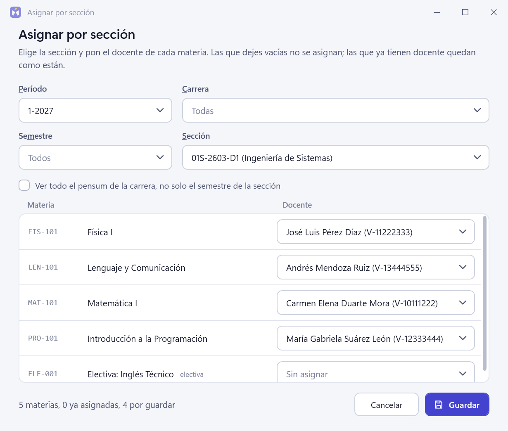

Repite con cada sección.

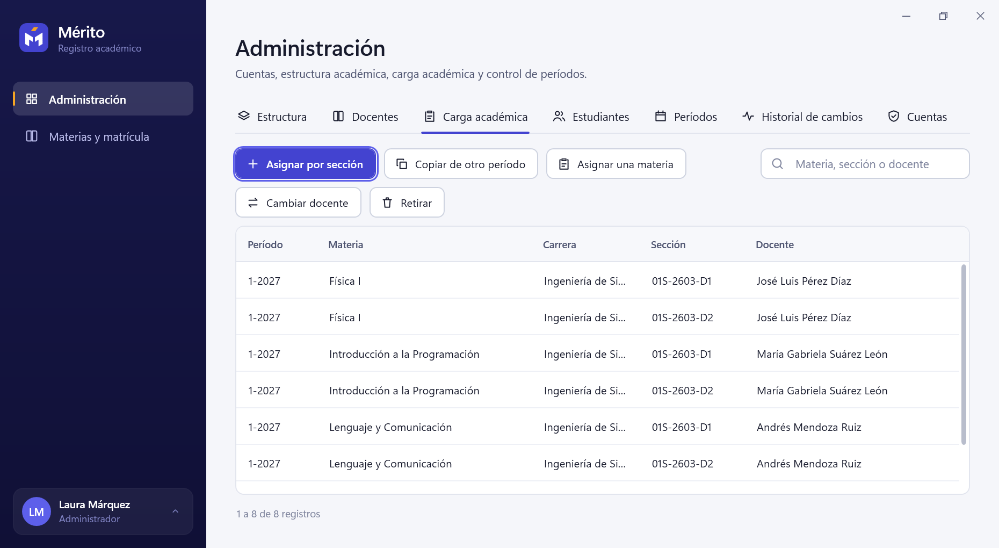

A partir del segundo período no hace falta repetir esto: **Copiar de otro período** copia toda la carga de un período anterior al nuevo, y después solo se corrigen los cambios.

### 6.10 Paso 9: los estudiantes inscritos

Se hace en la pestaña **Estudiantes**, con el botón **Importar estudiantes**.

1. Pulsa **Plantilla** y guarda `matricula.xlsx`.
2. Llena una fila por estudiante: cédula, nombres, apellidos, carrera, sección y correo. La columna materias normalmente se deja vacía. El punto 9.2 explica todo con detalle.
3. Pulsa **Importar estudiantes**, elige el período y pulsa **Continuar**.

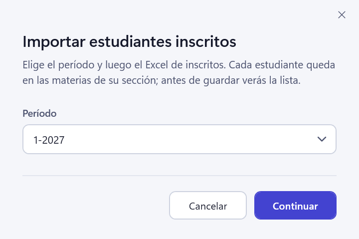

4. Elige el archivo.
5. Si hay errores, Mérito los muestra por número de fila y no guarda nada. En la imagen hay una cédula con letras, una carrera escrita sin tilde, una sección que no existe, un correo incompleto y una materia que esa sección no tiene.

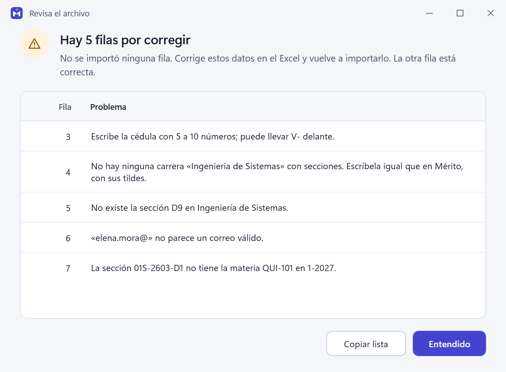

   Con **Copiar lista** se copian los errores para pasárselos a quien preparó el archivo. Se corrige el Excel y se vuelve a importar.

6. Si no hay errores, aparece la revisión: cada estudiante con su sección y en cuántas materias queda inscrito. Pulsa **Importar estudiantes**.

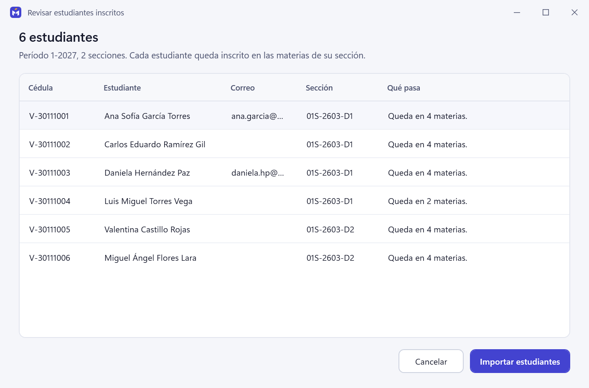

Cada estudiante queda inscrito en todas las materias asignadas a su sección. Si en la columna materias se escriben códigos, solo en esas. En el ejemplo, Luis Miguel queda en 2 materias porque su fila dice `MAT-101, PRO-101`.

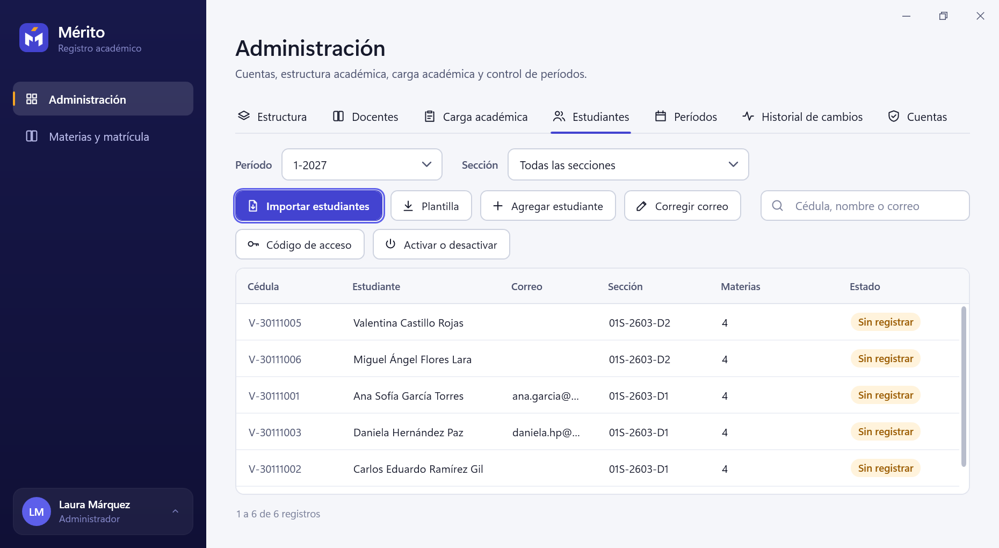

El mismo archivo se puede volver a importar con correcciones de última hora: lo que ya estaba no se duplica.

### 6.11 Paso 10: que cada persona cree su contraseña

Hasta aquí los docentes y estudiantes existen en Mérito, pero todavía no pueden entrar porque no tienen contraseña. En las pestañas Docentes y Estudiantes, la columna Estado dice **Sin registrar** hasta que la crean.

Hay tres maneras de hacerlo y se pueden combinar.

La primera forma es por correo. Funciona si se hizo el capítulo 4 y la persona tiene su correo en Mérito:

1. En la pantalla de inicio, la persona pulsa **¿Primera vez u olvidaste tu contraseña?**
2. Escribe su cédula y pulsa **Enviarme el código**.

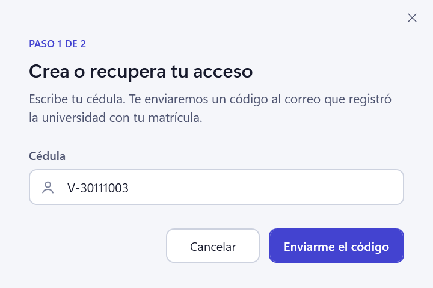

3. Le llega un correo con un código de 6 números. Lo escribe junto con su contraseña nueva y pulsa **Guardar contraseña**.

El código dura 15 minutos y admite 5 intentos. Si no llega, que revise la carpeta de correo no deseado. Para pedir otro hay que esperar un minuto.

La segunda forma es una hoja de códigos para toda una sección, lo más práctico para estudiantes sin correo. La genera el docente o administración desde la planilla de cualquier materia de la sección, pestaña **Matrícula**, botón **Códigos de acceso**:

1. Indica cuántos días durarán los códigos, de 1 a 30. Por defecto son 7.
2. Elige dónde guardar el PDF.
3. El PDF trae una tira recortable por cada estudiante que todavía no tiene contraseña, con su nombre, cédula, código y los pasos a seguir.
4. En clase, el docente entrega cada tira a su dueño después de ver su cédula o su comprobante de inscripción.

Si se genera otra hoja, los códigos de la anterior dejan de servir.

La tercera forma es un código individual, para casos sueltos o para alguien que olvidó su contraseña y no tiene correo. En las pestañas Docentes, Estudiantes o Cuentas, selecciona a la persona y pulsa **Código de acceso**. Mérito pregunta si verificaste su identidad y muestra el código. Ese código dura 30 minutos.

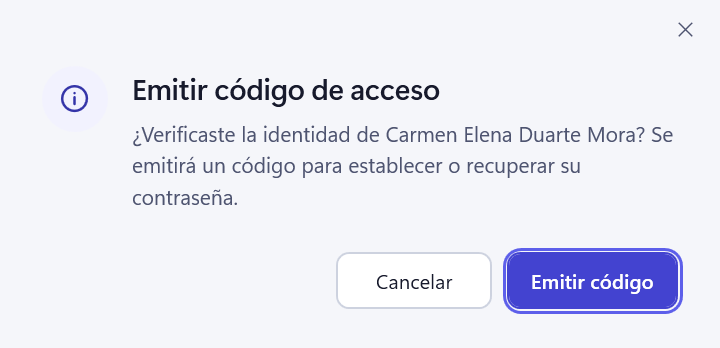

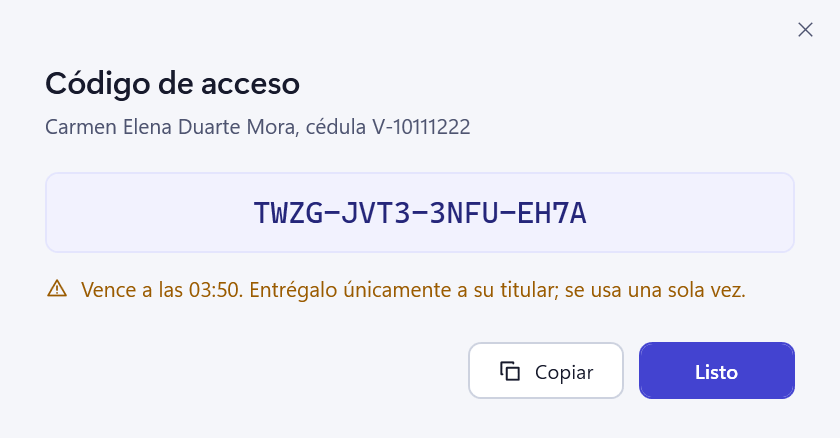

Con un código de la hoja o individual, la persona va a la pantalla de inicio y pulsa **Activar cuenta o recuperar acceso**. Si hay correo configurado, ese botón dice **Tengo un código de la universidad**. Escribe su cédula, el código y su contraseña nueva dos veces, y pulsa **Continuar**.

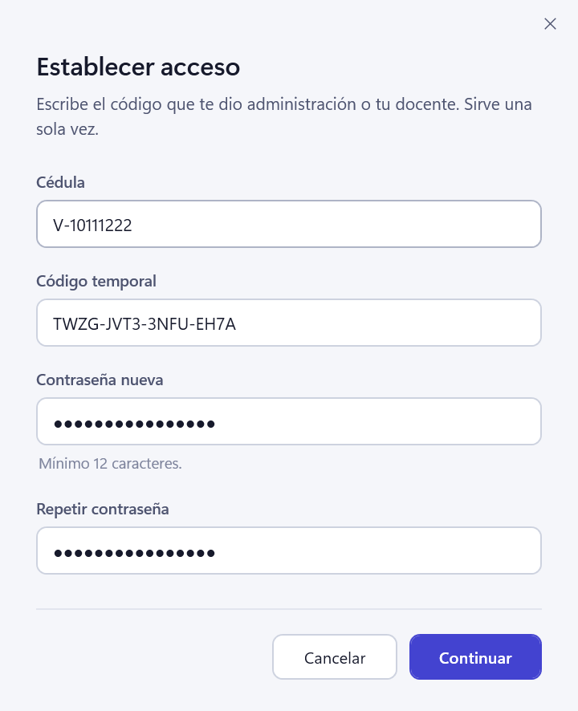

### 6.12 Lista de control de la primera configuración

| Hecho | Paso | Dónde |
|---|---|---|
| ☐ | Reglas de calificación | Períodos › Reglas de calificación |
| ☐ | Carreras con nombre oficial y código | Estructura › Carreras |
| ☐ | Formato del código de sección | Estructura › Secciones › Formato del código |
| ☐ | Pensum de cada carrera | Estructura › Pensum |
| ☐ | Secciones | Estructura › Secciones |
| ☐ | Período | Períodos › Nuevo período |
| ☐ | Nómina docente | Docentes › Importar nómina |
| ☐ | Carga académica de cada sección | Carga académica › Asignar por sección |
| ☐ | Estudiantes inscritos | Estudiantes › Importar estudiantes |
| ☐ | Contraseñas de docentes y estudiantes | Correo, hoja de códigos o código individual |
| ☐ | Segunda cuenta de administración | Cuentas › Agregar administrador |

Cada período nuevo solo hace falta: crear el período, copiar la carga del anterior y corregir lo que cambió, importar los inscritos y dar códigos a quienes sean nuevos.

## 7. El trabajo del docente

### 7.1 Entrar y abrir una materia

El docente entra con su cédula y su contraseña. Ve **Mis materias**, con las materias que le asignó administración.

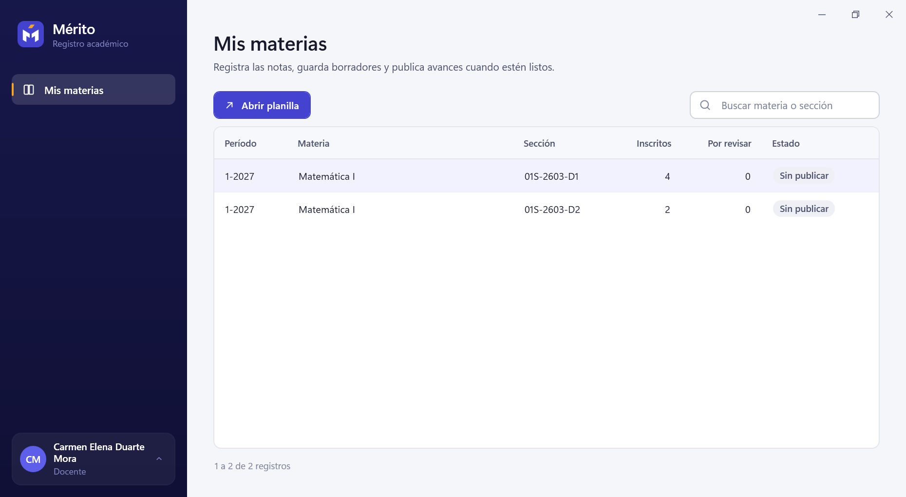

Selecciona una y pulsa **Abrir planilla**, o haz doble clic. Arriba de la planilla se ve la carrera, el período y la escala de notas.

### 7.2 Armar el plan de evaluación

En la pestaña **Evaluaciones**, pulsa **Agregar evaluación** por cada evaluación del semestre, con su nombre y su porcentaje.

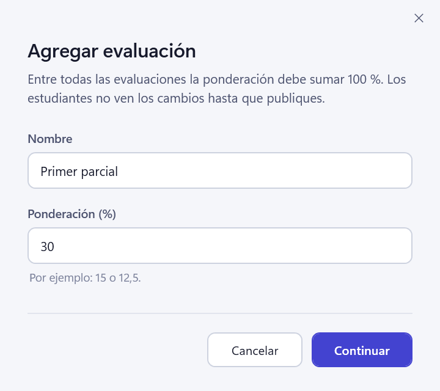

Los porcentajes tienen que sumar 100 %. Arriba dice «plan al 100 %» cuando ya está completo.

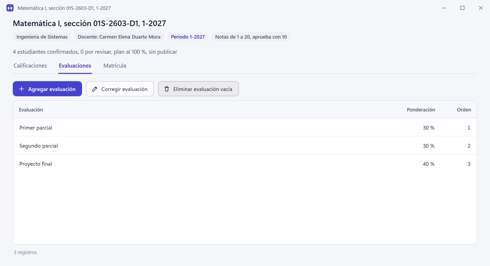

- **Corregir evaluación**: cambia el nombre o el porcentaje.
- **Eliminar evaluación vacía**: borra una evaluación que nunca tuvo notas.

### 7.3 Cargar las notas

En la pestaña **Calificaciones**, pulsa **Cargar notas** y elige la evaluación.

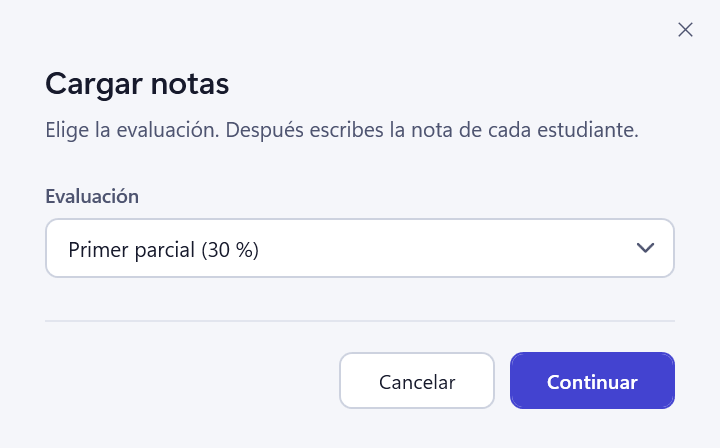

Aparece la lista del grupo. Escribe la nota de cada estudiante y pulsa Enter para pasar al siguiente. Los decimales se escriben con coma o con punto. Una casilla vacía significa que esa nota está pendiente, no que es cero.

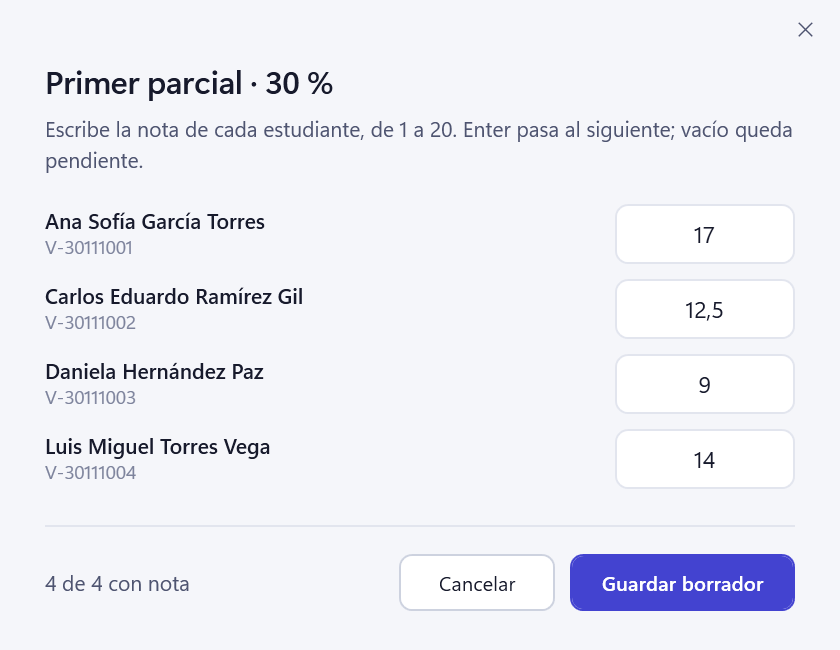

Si una nota está fuera de la escala, Mérito la marca en rojo y no deja guardar hasta corregirla.

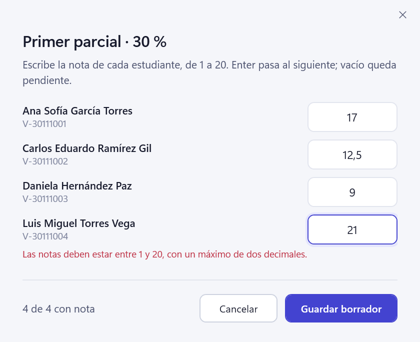

Pulsa **Guardar borrador**. Las notas quedan guardadas, pero los estudiantes todavía no las ven.

La planilla muestra para cada estudiante sus notas, el acumulado, la definitiva y si va aprobado o aplazado. La definitiva aparece cuando el plan suma 100 % y el estudiante tiene todas sus notas.

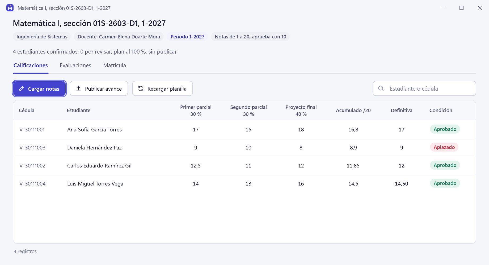

Para corregir las notas de un solo estudiante, haz doble clic sobre su fila.

### 7.4 Publicar

Cuando quieras que los estudiantes vean las notas, pulsa **Publicar avance** y confirma.

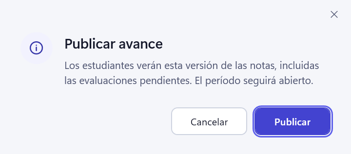

Desde ese momento cada estudiante ve sus notas en Mi récord. Se puede seguir corrigiendo y volver a publicar: lo publicado no cambia hasta la siguiente publicación.

### 7.5 La pestaña Matrícula

Muestra los estudiantes inscritos en la materia. Si falta alguien, el docente avisa a administración. También puede importarlo desde un Excel con **Importar Excel**, pero esa inscripción queda pendiente hasta que administración la confirme. Si sobra alguien, administración lo retira.

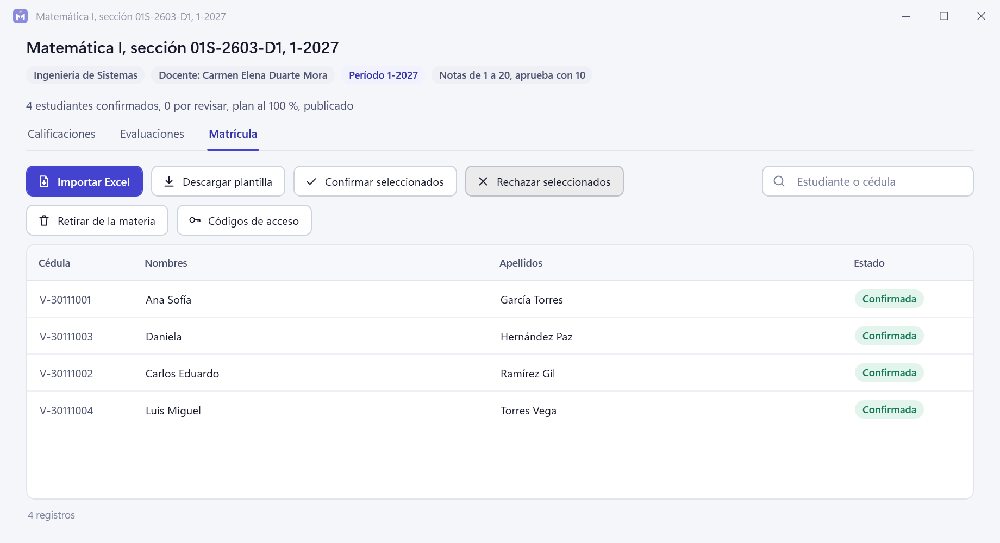

Aquí está también **Códigos de acceso**, la hoja de códigos explicada en el punto 6.11.

## 8. Lo que ve el estudiante

El estudiante entra con su cédula y su contraseña y ve **Mi récord académico**. Para cada materia aparecen sus evaluaciones con el porcentaje, la nota y los puntos que suma, el acumulado, la definitiva y si aprobó.

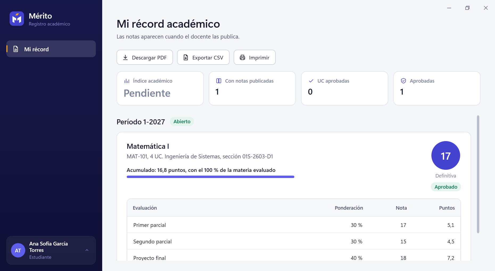

Arriba están el índice académico y las unidades de crédito aprobadas. Esos dos números solo cuentan los períodos cerrados; mientras el período está abierto dicen «Pendiente» o 0.

Con **Descargar PDF** guarda su récord, con **Exportar CSV** lo abre en una hoja de cálculo y con **Imprimir** lo imprime.

## 9. Los archivos de Excel

### 9.1 Reglas que valen para los tres archivos

- Hay que usar archivos `.xlsx`, el formato normal de Excel. No sirven `.xls` ni `.csv`. Si el archivo viene en otro formato, se abre en Excel y se guarda como «Libro de Excel».
- El archivo tiene que tener **una sola hoja**. Si tiene más, se borran las que sobran.
- Lo más fácil es partir de la plantilla que da Mérito, pero se puede usar un archivo propio. Mérito busca la fila de títulos en las primeras 10 filas.
- Las columnas se reconocen por su título, no por su lugar. Pueden ir en cualquier orden. No importan mayúsculas ni tildes en los títulos: «Cédula», «cedula» y «CEDULA» valen igual.
- Si el archivo trae columnas de más, como «Teléfono» u «Observaciones», Mérito las ignora.
- Si falta una columna obligatoria, Mérito dice cuál falta. Si una columna está dos veces, también lo dice.
- Las filas vacías se saltan.
- No puede haber fórmulas. Si los datos vienen de otro archivo con fórmulas, se copian y se pegan con **Pegado especial › Valores**.
- El archivo puede pesar como máximo 1 MB, lo que alcanza para miles de filas.
- La cédula se escribe con 5 a 10 números, con o sin `V-` delante. Los puntos y espacios no importan: `V-12.345.678`, `12345678` y `V12345678` son la misma cédula. Otras letras, como `E-`, no se aceptan.
- El correo es opcional. Si se escribe, tiene que estar completo, por ejemplo `nombre@gmail.com`, y no puede repetirse.
- Si hay errores, no se guarda **nada** del archivo. Se corrige y se vuelve a importar.
- Importar el mismo archivo dos veces no duplica nada.

### 9.2 Inscritos del período

Se importa en **Estudiantes › Importar estudiantes**. Plantilla: `matricula.xlsx`.

| Columna | ¿Obligatoria? | Otros títulos que acepta | Qué se escribe | Ejemplo |
|---|---|---|---|---|
| cédula | Sí | cedula de identidad, ci, c.i. | La cédula del estudiante. | V-30111001 |
| nombres | Sí | nombre | Sus nombres. | Ana Sofía |
| apellidos | Sí | apellido | Sus apellidos. | García Torres |
| carrera | Sí | | El nombre de la carrera igual que en Mérito, con sus tildes. | Ingeniería de Sistemas |
| sección | Sí | código de sección | El código completo de la sección o su nombre corto. | 01S-2603-D1 o D1 |
| correo | No | correo electrónico, email, e-mail | Su correo, para que cree su contraseña solo. | ana@gmail.com |
| materias | No | códigos de materias | Vacío: queda en todas las materias de su sección. Con códigos: solo en esas. | MAT-101, PRO-101 |

Así se ve un archivo correcto:

| cédula | nombres | apellidos | carrera | sección | correo | materias |
|---|---|---|---|---|---|---|
| V-30111001 | Ana Sofía | García Torres | Ingeniería de Sistemas | D1 | ana.garcia@ejemplo.com | |
| V-30111002 | Carlos Eduardo | Ramírez Gil | Ingeniería de Sistemas | D1 | | |
| V-30111004 | Luis Miguel | Torres Vega | Ingeniería de Sistemas | D1 | | MAT-101, PRO-101 |
| V-30111005 | Valentina | Castillo Rojas | Ingeniería de Sistemas | D2 | | |

Hay casos que se resuelven así:

- **Un estudiante que solo ve algunas materias de su sección**: se escriben sus códigos en la columna materias, separados por coma.
- **Un estudiante que arrastra una materia de otro semestre**: va en una segunda fila, con la sección donde la ve y el código de esa materia. La misma cédula puede aparecer en varias filas, siempre con el mismo nombre.
- **Una sección cuyo nombre corto se repite** en la carrera, como D1 de primero y D1 de tercero: hay que escribir el código completo, porque con «D1» Mérito no sabe cuál es.

Mérito no inscribe a un estudiante en una materia que ya aprobó ni en una que ya está viendo en otra sección del mismo período. Esas aparecen en la revisión con el motivo, y el resto de la fila sí se inscribe.

Los errores que más salen y qué significan:

| Mensaje | Qué pasa |
|---|---|
| Escribe la cédula con 5 a 10 números; puede llevar V- delante. | La cédula tiene letras, otro prefijo o muy pocos números. |
| No hay ninguna carrera «Ingenieria de Sistemas» con secciones. | La carrera está escrita distinto que en Mérito, casi siempre por una tilde. |
| No existe la sección D9 en Ingeniería de Sistemas. | Esa sección no está creada en esa carrera, o su nombre está mal escrito. |
| La sección 01S-2603-D1 no tiene materias asignadas en 1-2027. | Falta hacer la carga académica de esa sección. |
| La sección 01S-2603-D1 no tiene la materia QUI-101 en 1-2027. | El código de la columna materias está mal escrito o esa materia no está asignada a esa sección. |
| «elena.mora@» no parece un correo válido. | El correo está incompleto o tiene espacios. |
| La cédula V-… está en la fila 5 con otro nombre o correo. | La misma cédula aparece dos veces con datos distintos. |
| La cédula V-… ya existe con otra identidad o cargo. | Esa cédula ya está en Mérito con otro nombre o es de un docente. |
| Faltan columnas: apellidos. | La fila de títulos no tiene esa columna, o tiene otro título. |

### 9.3 Nómina docente

Se importa en **Docentes › Importar nómina**. Plantilla: `nomina-docente.xlsx`.

| Columna | ¿Obligatoria? | Otros títulos que acepta | Qué se escribe |
|---|---|---|---|
| cédula | Sí | cedula de identidad, ci, c.i. | La cédula del docente. |
| nombres | Sí | nombre | Sus nombres. |
| apellidos | Sí | apellido | Sus apellidos. |
| correo | No | correo electrónico, email, e-mail | Su correo, para que cree su contraseña solo. |

Cada cédula va una sola vez. Si un docente ya estaba en Mérito con el mismo nombre, no se duplica; si no tenía correo y el archivo lo trae, se le agrega.

### 9.4 Pensum

Se importa en **Estructura › Pensum › Importar Excel**, con la carrera elegida arriba. Plantilla: `pensum.xlsx`. Un archivo por carrera.

| Columna | ¿Obligatoria? | Otros títulos que acepta | Qué se escribe | Ejemplo |
|---|---|---|---|---|
| código | Sí | código de materia | El código oficial: letras, números, puntos o guiones, hasta 20 caracteres. | MAT-101 |
| materia | Sí | asignatura, nombre de la materia | El nombre de la materia. | Matemática I |
| uc | Sí | u.c., unidades de crédito | Las unidades de crédito, un número entero de 0 a 60. | 4 |
| semestre | Sí, puede ir vacía | | El semestre, de 1 a 20. Vacío en las electivas. | 1 |

Si el código ya existe en Mérito, el nombre y las UC tienen que ser los mismos. Si no coinciden, Mérito lo marca como error para que nadie cambie una materia de otra carrera por accidente.

## 10. Todos los botones

En casi todas las listas hay arriba a la derecha un buscador: se escribe parte de un nombre, una cédula o un código y la lista se filtra al momento. La información se actualiza sola cada vez que se vuelve a la ventana de Mérito. La tecla F1 muestra los atajos de teclado.

Si un texto no cabe en su columna y termina en «…», al dejar el mouse encima aparece completo.

En los formularios, las listas desplegables también se filtran escribiendo. Con las flechas se mueve uno por la lista y con Enter se elige.

### 10.1 Pantalla de inicio

| Botón | Qué hace | Cuándo se usa |
|---|---|---|
| Configurar Mérito | Crea la primera cuenta de administración con el código de configuración. | Solo aparece la primera vez, en un servidor nuevo. |
| Iniciar sesión | Entra con cédula y contraseña. | Siempre. |
| Recordar mi cédula en este equipo | Deja escrita la cédula la próxima vez. La contraseña nunca se guarda. | Se desmarca en computadoras que usa mucha gente. |
| ¿Primera vez u olvidaste tu contraseña? | Envía un código al correo de la persona para crear o recuperar su contraseña. | Solo aparece si se configuró el correo. |
| Activar cuenta o recuperar acceso | Crea o recupera la contraseña con un código entregado por administración o por el docente. Con correo configurado se llama Tengo un código de la universidad. | Cuando la persona no tiene correo. |

La sesión dura 8 horas. Después Mérito pide entrar de nuevo.

### 10.2 Menú de la cuenta

Se abre pulsando el logo de Mérito, arriba a la izquierda, o el nombre de la persona, abajo a la izquierda.

| Opción | Qué hace |
|---|---|
| Cambiar contraseña | Pide la contraseña actual y la nueva dos veces. Al cambiarla se cierran todas las sesiones abiertas con esa cuenta y hay que entrar de nuevo. |
| Atajos de teclado | Muestra los atajos, igual que F1. |
| Cerrar sesión | Sale de la cuenta. Si hay notas sin guardar, pregunta antes. |

### 10.3 Administración › Estructura

| Apartado | Botón | Qué hace | Cuándo se usa |
|---|---|---|---|
| Carreras | Agregar | Crea una carrera. | Configuración inicial o carrera nueva. |
| Carreras | Corregir | Cambia nombre o código. Si cambia el código, se actualizan los códigos de sus secciones. | Para corregir un error. |
| Pensum | Importar Excel | Carga el pensum de la carrera elegida desde un Excel. | Configuración inicial o cambio de pensum. |
| Pensum | Plantilla | Guarda la plantilla vacía del pensum. | Antes de armar el archivo. |
| Pensum | Materia nueva | Crea una materia y la pone en el pensum de la carrera elegida. | Una materia que no existe en ninguna carrera. |
| Pensum | Agregar existente | Pone en esta carrera una materia que ya existe en otra. | Materias compartidas, como las del ciclo básico. |
| Pensum | Corregir | Cambia código, nombre, UC, nota aprobatoria propia o semestre. | Para corregir un error. Si la materia está en varias carreras, el aviso lo dice. |
| Pensum | Quitar del pensum | Saca la materia de esta carrera. | Solo si nunca se asignó en esta carrera. |
| Secciones | Agregar | Crea una sección. | Configuración inicial o sección nueva. |
| Secciones | Corregir | Cambia semestre o nombre corto; el código se actualiza solo. | Para corregir un error. |
| Secciones | Formato del código | Define cómo se arma el código de todas las secciones. | Una vez, al configurar. |

### 10.4 Administración › Docentes

| Botón | Qué hace | Cuándo se usa |
|---|---|---|
| Agregar docente | Crea un docente. | Un ingreso suelto. |
| Importar nómina | Carga varios docentes desde Excel. | Configuración inicial o varios ingresos. |
| Plantilla | Guarda la plantilla de la nómina. | Antes de armar el archivo. |
| Corregir correo | Cambia el correo del docente. Si se deja vacío, se le quita. | Correo mal escrito o nuevo. |
| Código de acceso | Muestra un código de 30 minutos para que cree o recupere su contraseña. | Después de verificar en persona que es él. |
| Activar o desactivar | Desactivar le impide entrar y cierra sus sesiones al momento. Sus datos se conservan. Activar lo revierte. | Cuando un docente deja la universidad. Las cuentas nunca se borran. |

### 10.5 Administración › Carga académica

| Botón | Qué hace | Cuándo se usa |
|---|---|---|
| Asignar por sección | Pone el docente de cada materia de una sección, todo en una pantalla. | La forma normal de armar la carga. |
| Copiar de otro período | Copia al período nuevo las materias, secciones y docentes de uno anterior. Lo que ya está asignado no se toca. | Al empezar cada período. |
| Asignar una materia | Asigna una sola materia de una sección a un docente. | Un caso suelto. |
| Cambiar docente | Pasa la materia a otro docente. Las notas se conservan. | Cuando cambia el docente a mitad de período. |
| Retirar | Quita de la carga una materia asignada por error. | Solo si todavía no tiene evaluaciones, estudiantes ni publicaciones. |

### 10.6 Administración › Estudiantes

Arriba se eligen el **Período** y, si se quiere, una **Sección**.

| Botón | Qué hace | Cuándo se usa |
|---|---|---|
| Importar estudiantes | Inscribe a los estudiantes del período desde Excel, todas las secciones juntas. | Al empezar el período y para cambios de última hora. |
| Plantilla | Guarda la plantilla de inscritos. | Antes de armar el archivo. |
| Agregar estudiante | Crea un estudiante. No lo inscribe en ninguna materia. | Un caso suelto; para inscribirlo hay que incluirlo en el Excel. |
| Corregir correo | Cambia el correo del estudiante. | Correo mal escrito o nuevo. |
| Código de acceso | Código de 30 minutos para que cree o recupere su contraseña. | Después de verificar su identidad. |
| Activar o desactivar | Le quita o le devuelve el acceso. Sus notas se conservan. | Retiro de la universidad. |

### 10.7 Administración › Períodos

| Botón | Qué hace | Cuándo se usa |
|---|---|---|
| Nuevo período | Crea un período. | Al empezar cada período. |
| Corregir nombre | Cambia el nombre de un período abierto. | Si se escribió mal. |
| Revisar cierre | Muestra, materia por materia, lo que falta para poder cerrar. | Antes de cerrar, y durante el período para ver quién va atrasado. |
| Cerrar período | Cierra el período: las notas quedan fijas y cuentan para el índice. No se puede deshacer. | Cuando Revisar cierre no muestra pendientes. |
| Reglas de calificación | Escala, nota aprobatoria, redondeo e índice. | Al configurar; después solo si cambia el reglamento. |

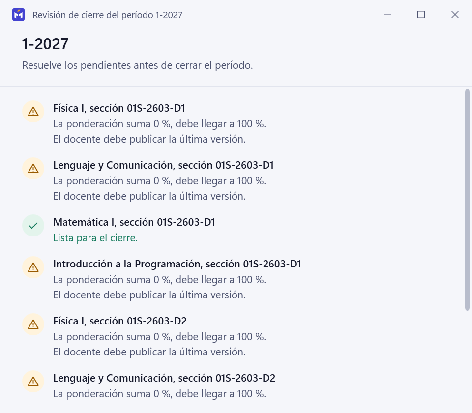

Revisar cierre avisa cuando una materia no tiene estudiantes confirmados, cuando tiene inscripciones pendientes, cuando su plan no suma 100 %, cuando le faltan notas o cuando el docente no publicó la última versión.

### 10.8 Administración › Historial de cambios

Una lista de todo lo que se ha hecho en Mérito: quién, qué y cuándo. Por ejemplo «Importó la matrícula del período 1-2027» o «Cambió el docente de Física I». Nadie puede modificarla ni borrarla. Sirve para responder «¿quién cambió esto?».

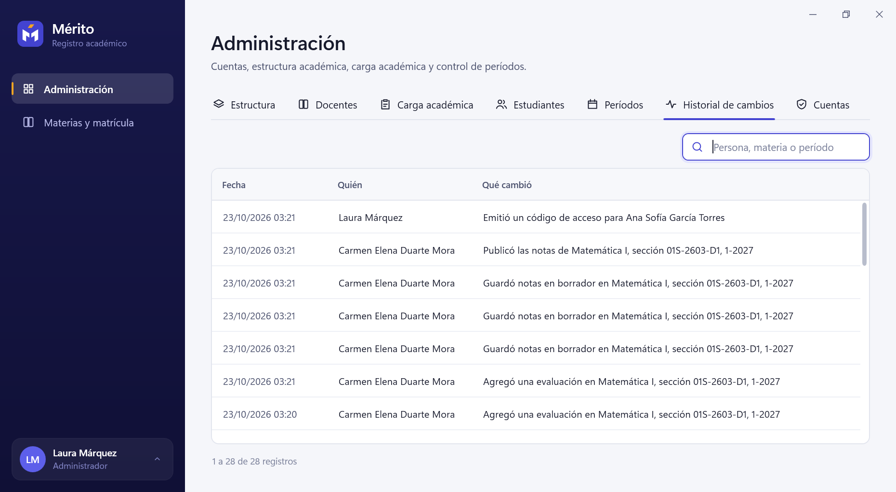

### 10.9 Administración › Cuentas

Solo las cuentas de administración.

| Botón | Qué hace |
|---|---|
| Agregar administrador | Crea otra cuenta de administración. |
| Corregir correo | Cambia su correo. |
| Código de acceso | Código de 30 minutos para que cree o recupere su contraseña. |
| Activar o desactivar | Le quita o le devuelve el acceso. Mérito no deja desactivar la propia cuenta ni quedarse sin ninguna administración activa. |

### 10.10 Materias y matrícula

Administración ve aquí todas las materias asignadas, con su sección, docente, inscritos y estado. **Abrir planilla** abre la planilla de la que esté seleccionada.

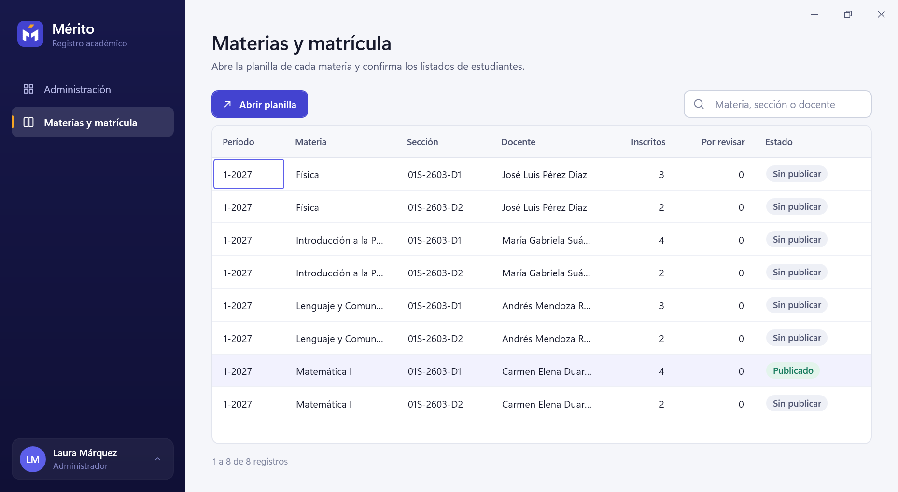

Administración puede ver las notas de la planilla, pero no cambiarlas: eso solo lo hace el docente.

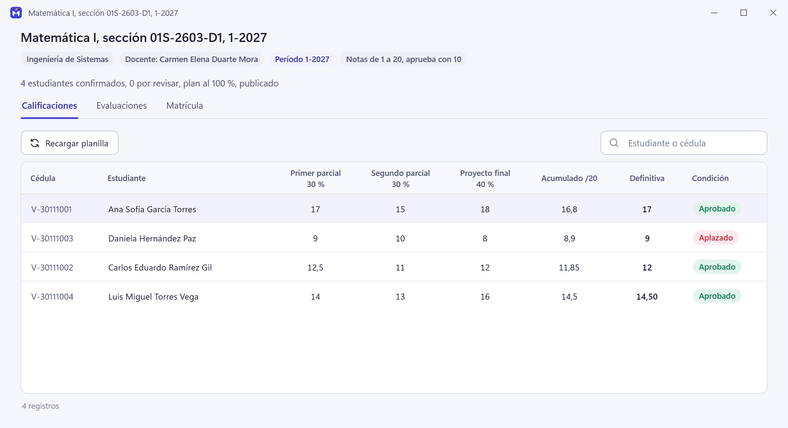

En la pestaña Matrícula de la planilla, administración tiene estos botones:

| Botón | Qué hace | Cuándo se usa |
|---|---|---|
| Importar Excel | Inscribe estudiantes solo en esta materia. | Cuando falta alguien en una sola materia. |
| Descargar plantilla | Guarda la plantilla de inscritos. | |
| Confirmar seleccionados | Confirma las inscripciones que propuso un docente. | Después de que un docente importó estudiantes. |
| Rechazar seleccionados | Descarta inscripciones propuestas. | Si la propuesta trae a alguien que no corresponde. |
| Retirar de la materia | Saca de la materia a estudiantes inscritos por error. Dejan de verla en su récord, pero sus notas quedan guardadas. | Solo con el período abierto. |
| Códigos de acceso | La hoja de códigos de la sección. | Primera semana de clases. |

Para seleccionar varios estudiantes a la vez se mantiene pulsada la tecla Ctrl mientras se hace clic.

### 10.11 Planilla del docente

| Pestaña | Botón | Qué hace |
|---|---|---|
| Calificaciones | Cargar notas | Carga las notas de una evaluación para todo el grupo. |
| Calificaciones | Doble clic en un estudiante | Corrige las notas de ese estudiante. |
| Calificaciones | Publicar avance | Hace visibles las notas para los estudiantes. |
| Calificaciones | Recargar planilla | Trae la última versión, por si alguien más guardó. |
| Evaluaciones | Agregar evaluación | Agrega una evaluación con su porcentaje. |
| Evaluaciones | Corregir evaluación | Cambia nombre o porcentaje. |
| Evaluaciones | Eliminar evaluación vacía | Borra una evaluación sin notas. |
| Matrícula | Importar Excel | Propone estudiantes; quedan pendientes hasta que administración los confirme. |
| Matrícula | Descargar plantilla | Guarda la plantilla de inscritos. |
| Matrícula | Códigos de acceso | La hoja de códigos de la sección. |

Con el período cerrado la planilla queda en solo lectura y estos botones desaparecen.

## 11. Cómo calcula Mérito las notas

- **Puntos de una evaluación**: la nota por el porcentaje, dividido entre 100. Un 15 en una evaluación de 30 % suma 4,5 puntos.
- **Acumulado**: la suma de los puntos de las evaluaciones que ya tienen nota.
- **Definitiva**: aparece cuando el plan suma 100 % y el estudiante tiene todas sus notas. Es el acumulado redondeado una sola vez, al final, según la regla que se eligió.
- **Aprobada o aplazada**: aprobada si la definitiva llega a la nota aprobatoria de la materia, o a la general si la materia no tiene una propia.
- **Índice ponderado**: cada definitiva se multiplica por las UC de su materia, se suman, y se divide entre el total de UC. Solo cuentan los períodos cerrados. Las materias de 0 UC no pesan.
- **Promedio simple**: el promedio de las definitivas de los períodos cerrados.
- **UC aprobadas**: la suma de las UC de las materias aprobadas en períodos cerrados.

Ejemplo con la planilla de la sección 7.3: Ana Sofía sacó 17 en el primer parcial de 30 %, 15 en el segundo de 30 % y 18 en el proyecto de 40 %. Sus puntos son 5,1 + 4,5 + 7,2 = 16,8. Con redondeo de medio punto, la definitiva queda en 17: aprobada.

## 12. Respaldos

### 12.1 El respaldo de todos los días

Mérito copia toda la información cada día, a la hora que se eligió al instalar, en la carpeta de respaldos. No hace falta hacer nada. Cada copia es un archivo con la fecha en el nombre, por ejemplo `merito_merito_20270310_220000.sql.gz`, junto con otro archivo terminado en `.sha256` que sirve para comprobar que la copia no se dañó. Las copias de más de 30 días se borran solas.

Lo único que queda a mano es **copiar la carpeta de respaldos fuera del servidor al menos una vez por semana**, a un disco externo, un pendrive u otra computadora. Si el disco del servidor se daña, las copias guardadas en ese mismo disco se pierden con él.

### 12.2 Hacer una copia en el momento

Conviene antes de cerrar un período o de instalar una versión nueva.

1. En el servidor, haz clic derecho sobre el botón Inicio y elige **Terminal (Administrador)** o **Windows PowerShell (Administrador)**.
2. Copia y pega estas dos líneas, una por una, pulsando Enter después de cada una:

```
cd "C:\Program Files\Merito\herramientas"
```

```
powershell -ExecutionPolicy Bypass -File .\respaldar.ps1 -MariadbDump "C:\Program Files\Merito\mariadb\bin\mariadb-dump.exe" -Opciones "C:\ProgramData\Merito\privado\respaldo.cnf" -BaseDatos merito -Carpeta "C:\ProgramData\Merito\respaldos"
```

3. Al terminar, muestra la ruta del archivo creado.

### 12.3 Recuperar la información desde una copia

Esto reemplaza toda la información actual por la de la copia. Lo que se haya hecho después de esa copia se pierde. Se usa solo si se dañó la información o hubo un error grave.

1. Detén el servicio Mérito: tecla Windows, `services.msc`, Enter, clic derecho sobre **Mérito** y **Detener**. No detengas MeritoBD.
2. Abre **Terminal (Administrador)** como en el punto anterior.
3. Pega estas dos líneas. En la segunda, cambia el nombre del archivo por el de la copia que quieres usar:

```
cd "C:\Program Files\Merito\herramientas"
```

```
powershell -ExecutionPolicy Bypass -File .\restaurar.ps1 -Mariadb "C:\Program Files\Merito\mariadb\bin\mariadb.exe" -Opciones "C:\ProgramData\Merito\privado\raiz.cnf" -Archivo "C:\ProgramData\Merito\respaldos\merito_merito_20270310_220000.sql.gz" -BaseDestino merito -Reemplazar
```

4. Debe responder «Restaurado en merito: versión de esquema 8, …». Si dice «La huella no coincide», esa copia está dañada y no se tocó nada: prueba con la del día anterior.
5. Vuelve a `services.msc` y pulsa **Iniciar** sobre Mérito.

## 13. Actualizar, mover o desinstalar

- **Instalar una versión nueva**: se ejecuta el instalador nuevo, primero en el servidor y después en cada cliente. Recuerda solo la carpeta, el papel del equipo y la dirección del servidor. No se pierde ninguna información ni la configuración del correo.
- **Desinstalar un cliente**: Configuración de Windows › Aplicaciones › Aplicaciones instaladas › Mérito › Desinstalar.
- **Desinstalar el servidor**: igual. Pregunta si borrar también la información y los respaldos. Si se responde que no, quedan guardados en `C:\ProgramData\Merito` y una instalación nueva los recupera.
- **Pasar el servidor a otra computadora**: se hace una copia en el momento como en 12.2, se instala el servidor en la computadora nueva, se copia ahí el archivo de la copia, se recupera como en 12.3 y se reinstalan los clientes con la IP nueva. No hace falta el código de configuración: las cuentas vienen dentro de la copia. Si había correo configurado, se copia también `correo.json` y se reinicia el servicio.

## 14. Si algo no funciona

| Qué pasa | Qué revisar |
|---|---|
| Un cliente no se conecta al servidor | Que el servidor esté encendido. Que en el navegador del cliente responda `http://IP-DEL-SERVIDOR:5187/salud`. Que la red del servidor esté como privada. Que la IP del servidor no haya cambiado. |
| Ni en el propio servidor responde `/salud` | En `services.msc`, los servicios Mérito y MeritoBD deben estar «En ejecución». Si Mérito no arranca, el Visor de eventos, origen Merito, explica por qué. |
| No aparece «¿Primera vez u olvidaste tu contraseña?» | El correo no está configurado o el archivo tiene un error. Ver el punto 4.3. |
| El código no llega al correo | Revisar el correo no deseado. Revisar que el correo de la persona esté bien escrito en Mérito. Que el servidor tenga internet. |
| «Cédula o contraseña incorrectas, o cuenta sin activar» | La persona todavía no creó su contraseña, la escribió mal o su cuenta está desactivada. Revisar la columna Estado. |
| Un docente no ve una materia | Que esté asignada a su nombre en Carga académica, en un período abierto. |
| Un estudiante no ve una materia | Que esté inscrito en ella y que el docente ya haya publicado. |
| «Otra operación modificó esta planilla» | Otra persona guardó la misma planilla. Pulsar Recargar planilla. |
| No deja cambiar la escala de notas | Ya hay notas cargadas. Se pueden cambiar la nota aprobatoria, el redondeo y el índice, pero no la escala. |
| No deja cerrar el período | Revisar cierre dice qué falta en cada materia. |
| Sale un error con una «referencia» | Anota o copia esa referencia y pásasela a sistemas. Con ella se encuentra el detalle en el Visor de eventos del servidor. |
| Se perdió el código de configuración | Está en el servidor en `C:\ProgramData\Merito\privado\codigo-configuracion.txt`. |
| Nadie recuerda la contraseña de administración | Otra cuenta de administración le da un código desde Cuentas. Por eso conviene tener siempre dos. |

## 15. Seguridad

- Las contraseñas se guardan cifradas. Nadie puede verlas, ni administración ni sistemas.
- Los códigos de acceso sirven una sola vez y vencen.
- Las cuentas no se borran, se desactivan. Las notas y el historial se conservan siempre.
- La carpeta `C:\ProgramData\Merito\privado` guarda las claves internas de la base de datos y la del correo. No se copia a otras computadoras ni se envía por correo.
- Dentro de la red de la universidad, Mérito funciona sin configuraciones extra. Si la red es un Wi-Fi abierto al público, conviene que sistemas configure una conexión cifrada con certificado. En la documentación técnica está la opción que la exige.
